<p align="center">
  
</p>

<p align="center">
  <strong>Spotify 风格的桌面音乐播放器</strong><br />
  三栏结构 · 全屏播放 · 歌词 · 搜索 · 播客 · 本地音乐 · 自动更新
</p>

<p align="center">
  <a href="https://github.com/Wusshilan/spoteasy/releases/tag/v0.1.43"></a>
  <a href="https://github.com/Wusshilan/spoteasy"></a>
</p>

**当前版本：0.1.43** · Windows 10/11 · Electron 45 + React 19 + TypeScript + Vite

[下载安装包](https://github.com/Wusshilan/spoteasy/releases/tag/v0.1.43) · [源码仓库](https://github.com/Wusshilan/spoteasy) · [问题反馈](https://github.com/Wusshilan/spoteasy/issues)

## 实机截图

<table>
  <tr>
    <td width="50%">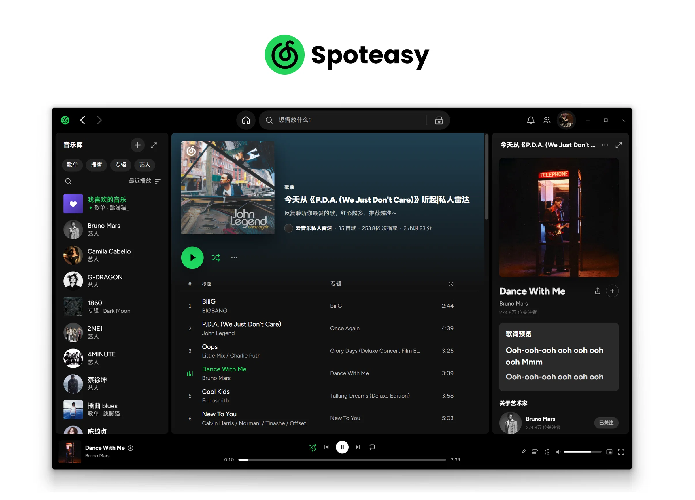</td>
    <td width="50%">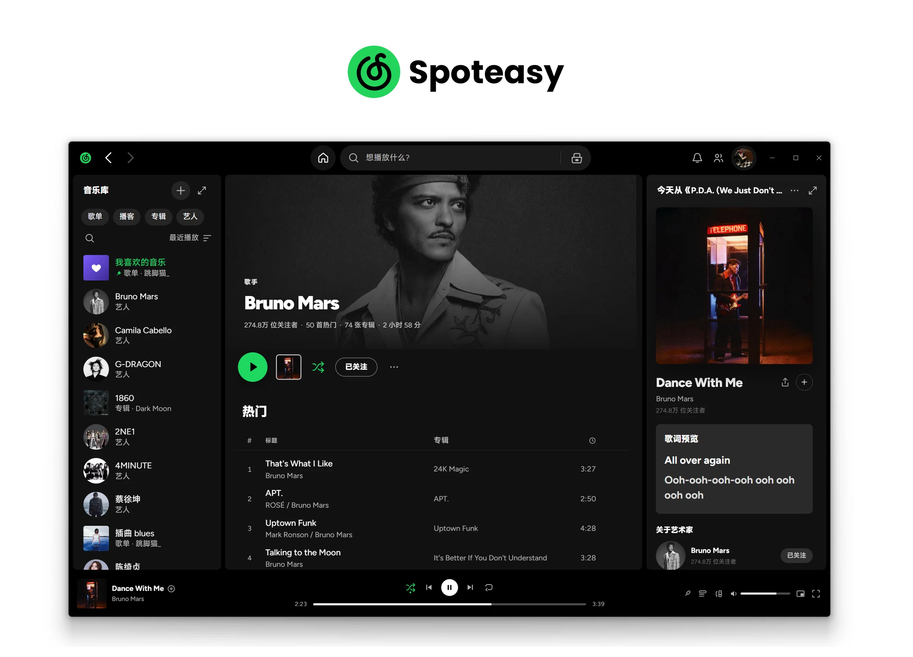</td>
  </tr>
  <tr>
    <td align="center"><sub>播放列表 · 曲目 · 正在播放</sub></td>
    <td align="center"><sub>艺人页 · 热门歌曲 · 关注状态</sub></td>
  </tr>
  <tr>
    <td width="50%">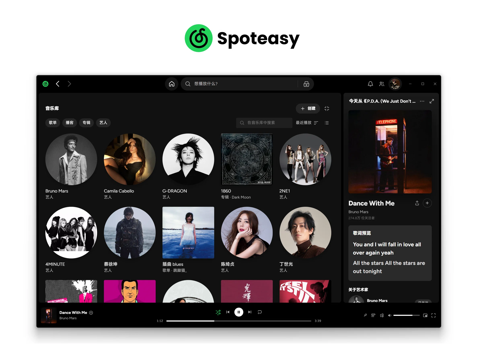</td>
    <td width="50%">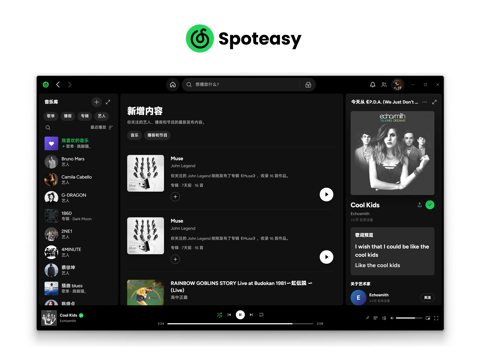</td>
  </tr>
  <tr>
    <td align="center"><sub>音乐库 · 艺人/专辑/歌单网格</sub></td>
    <td align="center"><sub>新增内容 · 关注艺人的新发布</sub></td>
  </tr>
  <tr>
    <td width="50%">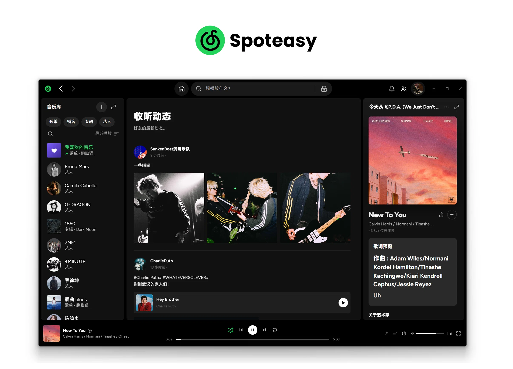</td>
    <td width="50%">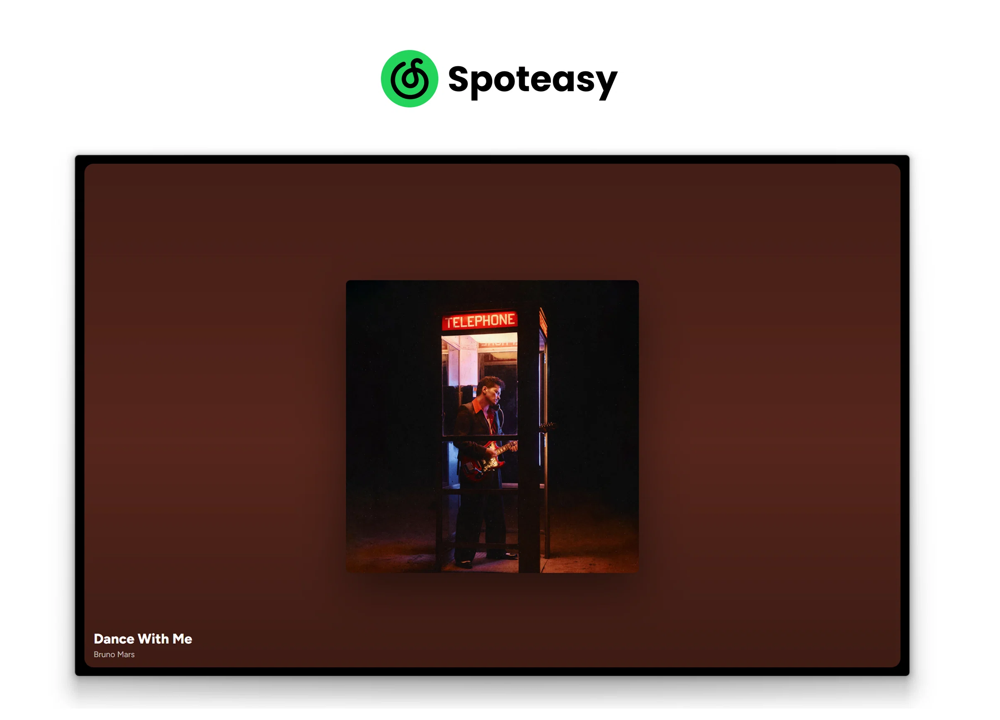</td>
  </tr>
  <tr>
    <td align="center"><sub>收听动态 · 好友正在收听</sub></td>
    <td align="center"><sub>全屏播放 · 封面主色背景</sub></td>
  </tr>
</table>

## 为什么是 Spoteasy

- **像 Spotify 一样用**：三栏布局、顶栏、播放条、队列、右键菜单、设置页，而不是套一层网页
- **网易云内容层**：搜索、歌单、专辑、艺人、MV、播客、每日推荐都能在站内打开
- **本地和云端统一**：本地文件夹扫描和网易云歌曲共用一套播放器、队列和歌词界面
- **全屏播放**：点击封面切换歌词，点击封面以外退出沉浸，封面主色背景
- **真正的桌面应用**：Electron 原生窗口、系统媒体键、本地缓存、GitHub Releases 更新
- **不藏假按钮**：没有接入的能力在设置页明确标记“未接入”，不做点击只弹 toast 的假功能

## 功能

- **Spotify 三栏结构**：侧栏音乐库、中间页面、右侧正在播放；顶栏搜索与窗口控制
- **播放**：队列、随机、循环、上一首/下一首、进度、音量、播放条和迷你播放器
- **全屏播放**：封面主色背景、点击封面切换歌词、歌词点击 seek、5 秒无操作沉浸模式
- **沉浸模式**：圆角卡片、全窗口黑场、上下展开/收回动画；点击封面以外退出
- **搜索**：网易云歌曲、播客、专辑、歌单、艺人、MV，以及本地歌曲/专辑/艺人；关键词高亮
- **音乐库**：本地文件夹扫描、歌单、播客、专辑、艺人；四种视图（仅标题和作者 / 列表 / 宽松 / 紧凑）并持久化
- **播客**：关注列表、播客详情、节目列表、单集播放
- **首页**：推荐、排行榜、每日推荐、你的节目/新单集；按歌单随机取色，日推封面读取
- **设置**：偏好设置、音质、音量、随机/循环、睡眠定时、缩放、紧凑音乐库、减少动态效果、缓存清理
- **更新**：识别到新 Release 时在主页图标前显示绿色「更新」胶囊，点击后才下载安装，不点击不更新
- **本地优先**：本地音频走 HTMLAudio；网易云音频走稳定的 `spoteasy-cloud://` 协议，启动后重新解析播放地址

## 安装

推荐下载 **Setup** 安装版：

- [Spoteasy-Setup-0.1.43.exe](https://github.com/Wusshilan/spoteasy/releases/download/v0.1.43/Spoteasy-Setup-0.1.43.exe)
- [Spoteasy-0.1.43-portable.exe](https://github.com/Wusshilan/spoteasy/releases/download/v0.1.43/Spoteasy-0.1.43-portable.exe)

安装版支持应用内更新；portable 版本不能可靠地自我覆盖更新。

## 自动更新

- 启动、窗口重新聚焦、每 30 分钟检查 GitHub 最新 Release
- 仅当最新版本大于当前版本时，在主页图标前显示绿色「更新」胶囊
- 用户点击胶囊后才会下载 `Spoteasy-Setup-*.exe` 并启动安装
- 不点击不会下载、不会安装
- 当前版本与最新 Release 同为 0.1.43 时不会显示胶囊
- 升级实测需要先发布 **0.1.44**；安装包尚未签名，Windows 可能提示未知发布者

## 开发

要求 Node.js 20+、pnpm。

```bash
pnpm install
pnpm run dev
pnpm run build
pnpm run pack:win
```

Windows 打包产物在 `release/`。

## 技术结构

- `electron/main.cjs`：窗口、IPC、网易云 API、封面取色、更新检查/下载、媒体代理
- `electron/preload.cjs`：`window.spoteasy` 安全桥
- `src/state/`：播放器、网易云、本地库、UI 状态
- `src/components/`：首页、搜索、音乐库、播客、播放条、全屏播放、设置
- `src/styles/global.css`：Spotify 风格布局和动效

## 已知限制

- 真实账号写操作（收藏、关注、加入歌单、取消关注）仍需测试账号验证
- 搜索还缺用户、节目单集、筛选和排序
- 部分 Spotify 设置（Canvas、社交动态、淡入淡出、无缝、自动混音、音量标准化、单声道、均衡器）尚未接入，界面中标记为「未接入」
- 安装包未签名；自动更新只覆盖 NSIS 安装版
- 云同步没有后端，当前不做账号云同步

## 更新日志

## 0.1.43 多语言、首页与沉浸模式修复

- 新增界面语言：简体中文、繁體中文（香港）、繁體中文（台灣）、English
- 语言设置放入“偏好设置”，选择后立即生效并持久化
- 首页问候语加入当前用户名，并加倍问候语与卡片之间的间距
- 播放条封面点击进入全屏播放时增加展开动画
- 移除全屏播放卡片上的渐变遮罩
- 沉浸模式左下角标题固定回卡片左下角
- 退出沉浸模式取消黑屏渐变，只保留卡片收回
- 保留 60% 圆角平滑、10 段均衡器和首页分类歌单

## 0.1.42 均衡器、首页推荐栏目与设置优化

- 新增 10 段均衡器，支持平直/流行/摇滚/爵士/古典/低音/人声/电子预设和自定义增益
- 均衡器接入播放音频链，开机恢复，播放时自动恢复 AudioContext
- 首页新增华语流行、电子、摇滚、民谣、说唱、轻音乐推荐栏目
- 设置页移除偏好设置中重复的播放控制，播放相关设置集中到“播放”标签
- 偏好设置中的播放增强改为均衡器入口，不再显示“未接入”的假状态
- 搜索歌曲改走 cloudsearch，封面真实且互不重复
- 搜索最近记录支持专辑、歌单、艺人、MV 跳转
- 主内容区隐藏占位滚动条，艺人页头图贴齐右边缘
- 全屏背景取色、沉浸 FLIP、公开模式关注艺人等沿用 0.1.41 优化
- 版本号升至 0.1.42

## 0.1.41 搜索封面、滚动条与稳定性

- 歌曲搜索改走 cloudsearch，修复搜索歌曲共用默认人像、专辑封面缺失
- 搜索结果封面统一 160px、艺人头像 120px，并通过 spoteasy-img:// 代理加载
- 主内容区隐藏占位滚动条，艺人页头图和内容不再被 12px 滚动条挡出间隙
- 修复搜索最近记录点击专辑、歌单、艺人、MV 无反应
- 公开关注艺人读取成功，最多展示 6 位，带缓存和串行间隔
- 给公开关注艺人增加 10 分钟缓存，减少重复资料请求
- 全屏背景取色改为 64px 缩略图和 8×8 采样
- 沉浸展开/收回使用封面 FLIP；收回只收拢卡片，不做渐变
- 沉浸中点击封面可展开/收回歌词
- 扫码登录后自动匹配该账号的公开主页
- 版本号升至 0.1.41

## 0.1.40 公开模式、搜索缩略图

- 默认公开模式：输入 UID 或搜索用户名选择用户，不扫码也能浏览公开主页
- 公开模式只保存 UID，不保存 cookie；搜索、歌单、专辑、艺人、歌词、MV、播客等公开请求不带账号身份
- 公开主页显示公开歌单和公开喜欢的音乐；公开喜欢为只读，登录后才能写入
- 删除 30 秒登录状态轮询；搜索、首页和艺人相关请求改成串行加载
- 公开用户选择入口：顶栏头像菜单、设置页账号区、音乐库空状态
- 搜索修复：搜索结果封面改为 160px、头像改为 120px 缩略图，并修正重复 `param` 导致大图加载失败
- 音乐库全页补齐四视图：仅标题和作者、列表、宽松、紧凑，与侧栏同步并持久化
- 设置页新增偏好设置、缩放、紧凑音乐库、减少动态效果等 0.1.32 改动
- 版本号升至 0.1.40

## 0.1.32 沉浸退出反向动画

- 退出沉浸时不再先恢复原界面再等黑场消失
- 卡片从 `inset:16px` 反向收回为 `inset:72px 16px`，0.4s
- 黑场与卡片收回同步从 opacity 1 淡出到 0
- 动画结束后才移除沉浸状态，露出原界面
- 保留点击封面以外退出、封面点击不退出

## 0.1.31 沉浸黑场、高分辨率封面

- 沉浸进入时增加全窗口黑色背景层，卡片四周全部变黑，不再露出顶栏/播放条/页面内容
- 沉浸卡片仍为四边 16px 留边和圆角，上下展开动画保留
- 网易云封面分辨率提高：
  - 歌曲封面 320 → 1024
  - 歌单 400 → 800
  - 专辑 600 → 1000
  - 艺人/播客/节目 400/320 → 800
- 全屏播放封面额外把旧快照 URL 的 `param=320y320` 替换为 `param=1024y1024`，重启后旧队列封面也会变清晰

## 0.1.30 沉浸卡片展开动画、封面切歌词

- 沉浸卡片 final `inset: 16px`，`height:auto`、`max-height:calc(100vh - 32px)`，修复底部被裁掉没有边距
- 进入动画改成明显的上下展开：`inset: 72px 16px` → `16px`，0.58s；退出反向 0.38s，四角圆角保留
- 点击封面切换歌词：歌词区在左，封面在右；再点封面恢复只有封面
- 沉浸模式下点击封面不退出、不触发歌词；必须点击封面以外区域才退出

## 0.1.29 沉浸卡片动画、点击退出、媒体图片与首页取色

- 沉浸模式改为有边距的圆角卡片：固定 `inset: 8px`、`border-radius: 14px`，四边留白一致；进入时上下边框从 20px 收到 8px，退出反向展开
- 沉浸模式内移动鼠标不再退出；必须在软件内点击一次才退出，且这次点击不会触发封面/按钮
- 封面移除 3D 视差、缩放、hover 阴影/明暗变化
- CSP 增加 `http:` 图片/媒体/连接，修复网易云图片和媒体被拦截；封面/头像继续懒加载
- 歌单创建者增加 creator/name/owner/user 多级回退
- 首页主色改为从推荐/资源/榜单歌单中随机取一个封面色；每日推荐卡片读取第一首日推的封面和 hue

## 0.1.28 搜索本地结果、Logo 80%、安全与加载优化

- 搜索页本地结果现在在“全部 / 歌曲 / 专辑 / 艺人”标签下都显示对应本地内容
- 顶部搜索下拉加入本地歌曲建议
- 所有 UI logo 缩到原来 80%：标题栏 24→19.2、顶栏 26→20.8、设置页 52→41.6
- 封面/头像图片增加 `loading="lazy"` 和 `decoding="async"`
- `index.html` 增加 CSP；connect-src 保留 https/ws，media-src 保留 spoteasy-cloud
- 沉浸动画未改动，保留 0.1.27

## 0.1.27 沉浸模式退出和进出动画

- **退出沉浸不再需要点击**
  - 鼠标移动、点击、按键、触摸任一操作都能退出
  - 鼠标移动立即触发退出，不需要额外点一下
  - 退出后再重新开始 5 秒计时
- **进出动画**
  - 进入沉浸：0.4s 淡入，右上操作区透明度过渡
  - 退出沉浸：0.32s 淡出，结束后恢复顶栏/播放条布局
  - 不会在动画中途误点到底层控件

## 0.1.26 5s 沉浸模式、封面视差、艺人播放键、搜索本地结果

- **播放页 5s 无操作自动沉浸**
  - NowPlayingFull 挂载后 5 秒无鼠标/键盘/触摸操作，自动进入沉浸模式
  - 沉浸时隐藏顶栏、播放条、右上操作区、歌词面板，只保留纯色封面背景、封面和左下角歌名/歌手
  - 鼠标移动、点击、按键立即退出沉浸并重新计时
  - 封面在沉浸模式居中，不显示播放键和光标
- **封面悬停**
  - 去掉封面上的绿色播放键
  - 改为鼠标在封面上移动时的 3D 视差倾斜（最大 6°），离开回正
  - 不缩放封面；保留阴影
- **艺人卡片播放键**
  - 恢复音乐库艺人卡片 hover 播放键
  - 播放键移到圆形头像右下角外侧，不再压在头像图片里
- **搜索优化**
  - 本地结果新增本地专辑、本地艺人分组，可直接进入对应本地专辑/艺人页
  - 最近搜索记录支持单条删除（hover 出现 ×），不再只能整组清空

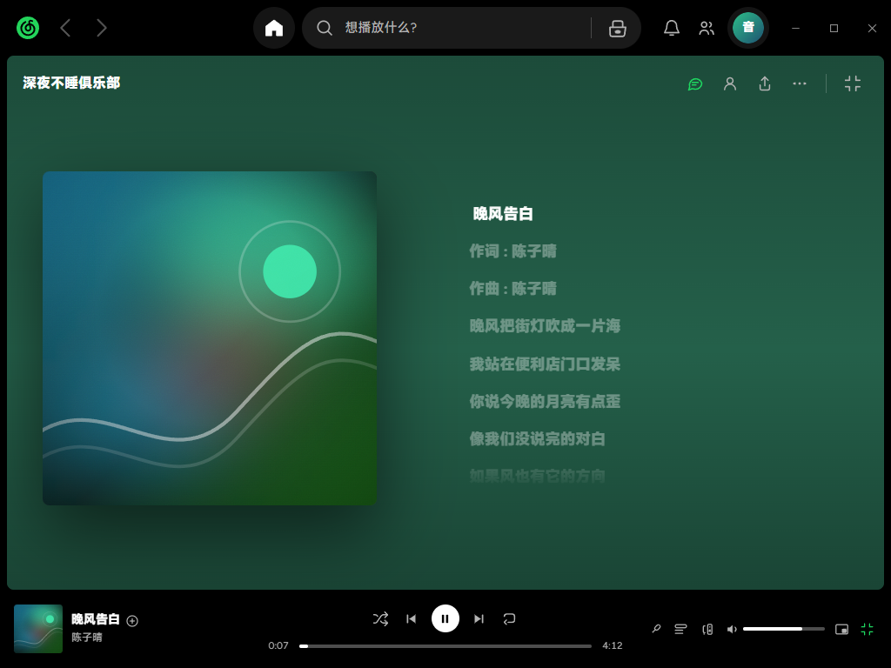
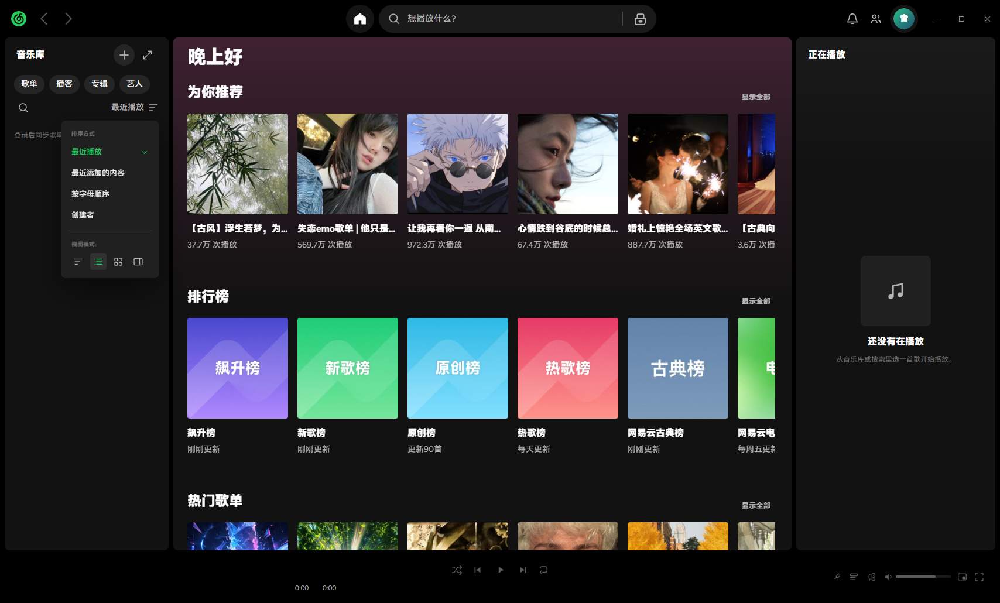

## 0.1.25 音乐库视图行高修复、菜单缩到 2/3、歌词切换动画

- **音乐库后两种视图**
  - 宽松视图：2 列，`grid-auto-rows: minmax(168px, auto)`，封面完整显示，标题和作者在封面下方
  - 紧凑视图：3 列，`grid-auto-rows: minmax(108px, auto)`，封面完整显示，标题在封面下方
  - 修复因 grid 行被压到 64px 导致的封面变成横条、标题被裁掉的问题
- **排序/视图菜单**
  - 宽度从固定 252px 改为侧栏宽度的 2/3：280px 侧栏 → 168px，248px 侧栏 → 149px
  - 四个视图按钮缩到 30px，菜单仍在侧栏内，不盖中间页面
- **全屏歌词切换动画**
  - 封面和歌词区从 grid 生硬跳变改为 flex 宽度过渡
  - 打开歌词时封面在 480ms 内平滑左移并略微收缩，歌词区从 0 宽度展开
  - 关闭歌词时反向收回；封面不缩放
  - 保留 0.1.24 的封面主色纯色背景、hover 遮罩和播放按钮


## 0.1.24 全屏封面纯色取色、去掉假播放键

- **全屏封面背景改为封面主色**
  - 不再使用 hue 渐变或模糊图层
  - `nativeImage` 采样封面后直接算主色，按适合大面积背景的明度/饱和度限制输出纯色
  - 窗口失焦、长时间不操作不会变成随机品红/橄榄 flat block；颜色和封面本身一致
  - 无封面时回退到歌曲自带 hue 对应的深色纯色
- **封面悬停去掉放大**
  - 不再缩放封面
  - 改为 Spotify 式暗色 hover 遮罩 + 右下角绿色播放/暂停按钮
  - 阴影保留，但不会改变封面尺寸
- **去掉无效播放键**
  - 音乐库全页的艺人卡片不再显示假的播放图标
  - 侧栏艺人行也不再显示假播放覆盖层
- 保留 0.1.23 的音乐库四视图：仅标题和作者 / 列表 / 宽松 / 紧凑


## 0.1.23 全屏封面取色/悬停、歌词标题移除、音乐库四种视图修正

- **全屏播放背景**
  - 不再依赖会掉帧的模糊封面图层；背景改为从封面 `nativeImage` 取色得到的 hue，生成径向 + 线性渐变
  - 窗口失焦、长时间不操作时不会再掉成纯品红/橄榄色 flat block
  - 封面本身继续显示；背景和封面颜色一致
- **封面悬停**
  - 鼠标移到封面时放大 1.025、阴影加深
  - 右下角出现绿色播放/暂停按钮，可直接控制播放
  - 点击封面仍然进入专辑
- **歌词**
  - 去掉歌词上方的“歌词”两个字，直接进入歌词行
  - 保留右上角歌词按钮、当前行高亮、点击 seek
- **音乐库视图模式**
  - 1「仅标题和作者」：无封面，只显示标题和作者
  - 2「列表模式」：48px 封面 + 标题/作者
  - 3「宽松视图」：2 列封面网格，标题/作者完整显示
  - 4「紧凑视图」：3 列封面网格，只显示标题
  - 修复后两种视图的封面/文字碰撞；选中视图后菜单自动关闭
  - 旧 `grid/mosaic` 状态自动迁移到新视图，避免刷新后错位


## 0.1.22 随机图标、排序菜单适配、全屏歌词分栏、多尺寸修复

- **随机播放图标**
  - 按图 1 换成标准的双交叉箭头：左下→右上、左上→右下，两个箭头都指向右侧
  - 保留原有 19px 尺寸和选中态绿点，不改变播放条整体比例
- **音乐库排序菜单**
  - 菜单宽度改为按侧栏宽度动态计算：280px 侧栏用 252px，248px 侧栏用 224px
  - 菜单右对齐到“最近播放”按钮，不再向右盖住中间首页内容
  - 四个视图模式按钮缩小到 36px，窄侧栏也能全部放下
  - 修复图 2/3 中菜单超出音乐库、压住主内容的 bug
- **全屏播放歌词**
  - NowPlayingFull 右上角新增歌词按钮（绿色激活）
  - 点击后封面左移，右侧出现可滚动歌词；当前行白色，其余灰色
  - 点击任意歌词行真实 seek；切歌自动重新拉歌词
  - 1024×640 小高度、1024×768、1366×768、1708×1030 都验证过，封面和歌词不会互相遮挡
- **多尺寸适配**
  - 排序菜单按侧栏宽度收缩
  - 全屏歌词在窄容器下自动上下堆叠，宽屏保持左右分栏
  - 顶栏、播放条、首页三卡片在 1024 宽度下保持对齐，不重叠


## 0.1.21 P0 稳定性、播客全链路、三卡片对齐

- **全局登录失效**
  - 主进程记录是否有过网易云 session，cookie 失效时 `status` 返回 `sessionExpired`
  - 渲染进程每 30 秒和窗口重新聚焦时刷新状态
  - 所有页面顶部统一显示登录失效条，可直接重新登录；不再只有好友动态/音频错误时才发现
- **媒体 URL 过期**
  - 检查后确认网易云歌曲保存的是稳定的 `spoteasy-cloud://stream/<id>` 协议地址，不是会过期的 http 直链
  - 主进程每次播放时重新解析真实 URL，并有 8 分钟缓存和 403/404 重试；队列/自建歌单重启后仍可播放
  - 播客单集也走同一协议，`dj_program.mainSong.id` → `spoteasy-cloud://stream/<id>`
- **播客全链路**
  - 新增 `dj_sublist` 已关注播客、`dj_detail` 播客详情、`dj_program` 节目列表
  - 侧栏新增“播客”筛选、播客行、右键取消关注/置顶/分享
  - 搜索里的播客结果改为进入站内播客页，不再打开网易云网页；最近搜索也走站内路由
  - 新增 `#/podcast/<id>`：封面、主播、关注数、简介、关注/取消关注、分享、节目列表、加载更多
  - 单集可真实播放，使用独立 `ne-program-<id>` 曲目 ID，不影响普通歌曲
  - 首页新增「你的节目」「新单集」；音乐库新增播客筛选
- **三大卡片对齐/圆角**
  - 首页 main-shell 恢复 8px 圆角，和左右卡片统一顶部 64px、底部同一位置
  - 修复 `.home-greeting` 的 12px margin 折叠到 `.home` 外层导致的顶部黑色空隙；背景渐变改挂到 main-shell，滚动条区域也被覆盖
  - 首页仍是通栏 Spotify 渐变，没有灰色卡片描边

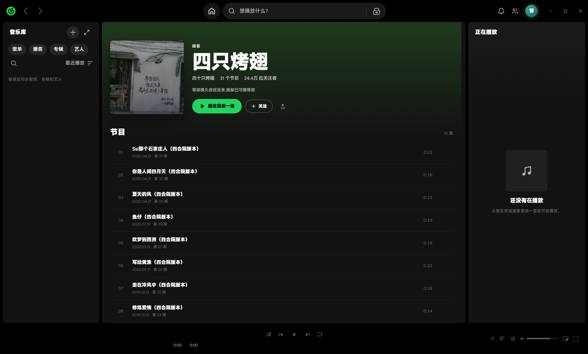
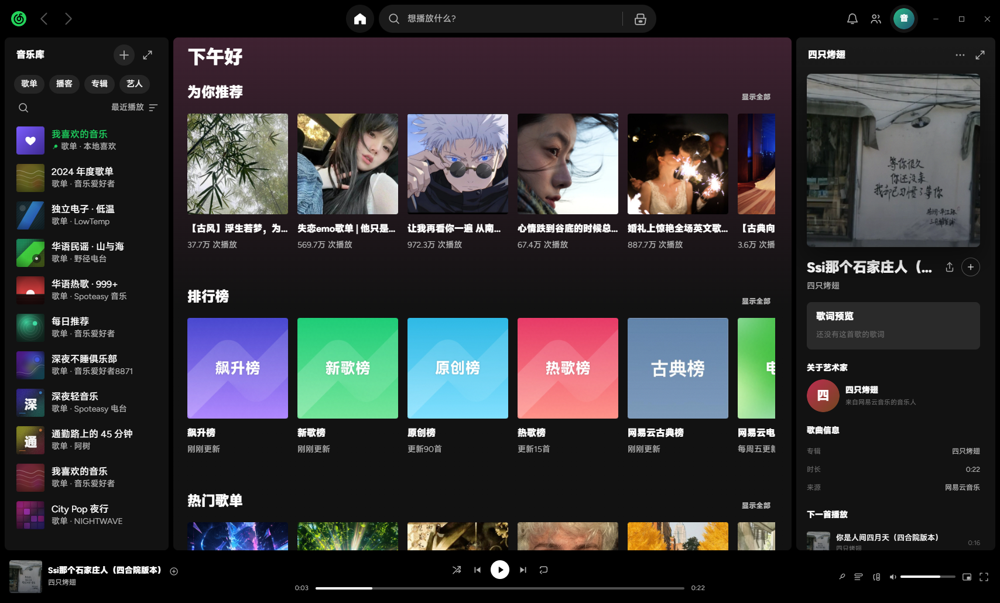

## 0.1.20 首页 Spotify 渐变、去掉灰色卡片/黑色描边、搜索框单层化

- **首页不再是一张灰色圆角卡片**
  - 去掉 main-shell 在首页的灰色卡片背景、边框、圆角和阴影
  - 首页改为通栏 Spotify 式渐变：使用首条推荐（没有推荐时用当前播放封面）的色相，从有色渐变过渡到 #121212
  - `.home::before` 旧灰黑渐变层删除；不再出现灰色卡片顶部/边缘的黑色 stroke
- **搜索框不再有第二层灰色卡片**
  - 删除 0.1.x 早期 SearchOverlay 遗留的全局 `.search-box` 背景、52px 高、圆角、内边距和 focus-within 灰底
  - 只保留顶栏外层 `.search-pill` 这一层；输入、清空、浏览按钮都在同一个 pill 内，和 Spotify 搜索框一致
  - 修复“搜索框外面套一圈莫名其妙的灰色卡片”
- **顶栏与搜索框**
  - 继续使用三列 grid；窄窗口搜索框不会压住 home / 右侧按钮
  - 搜索框高度、左右内边距、浏览图标、分隔线保持 0.1.19 规格


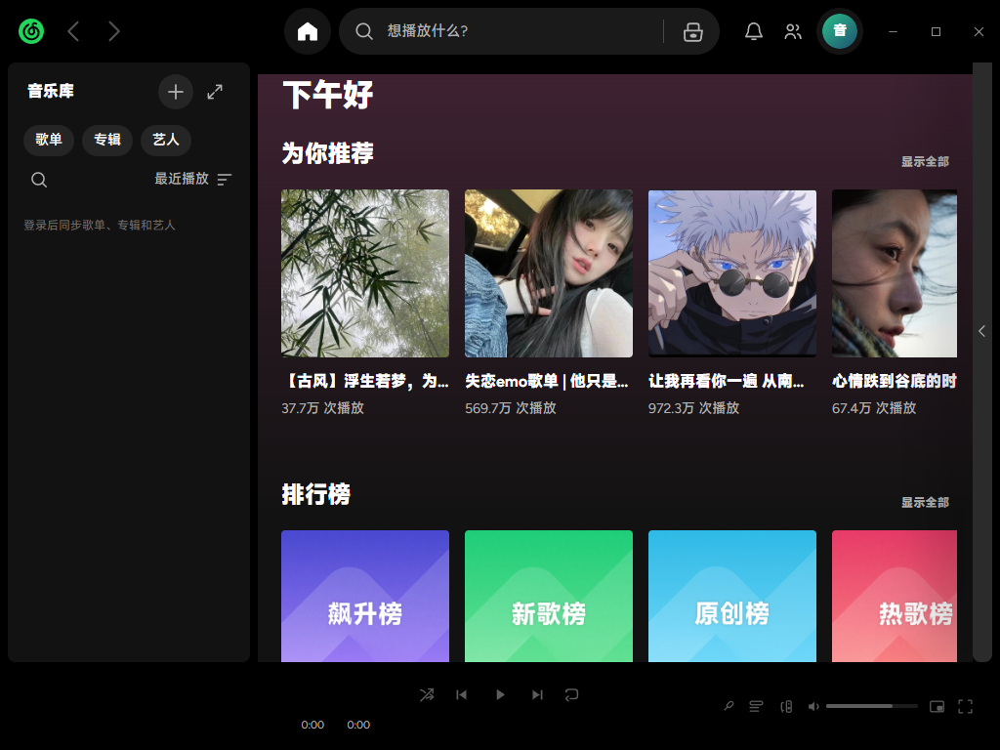

## 0.1.19 音乐库右键菜单、排序视图菜单、顶栏与首页视觉修复

- **音乐库歌手右键**
  - 取消关注（真实网易云接口）
  - 不要播放此艺人的歌曲（本机持久屏蔽）
  - 置顶艺人 / 取消置顶（持久化，排序时置顶项优先）
  - 转至艺人电台（拉取该艺人热门歌曲并随机开播）
  - 举报（打开网易云官方投诉页）
  - 分享 › 复制艺人链接
- **音乐库专辑右键**
  - 从音乐库中删除（真实取消收藏）
  - 加入播放队列（拉取专辑曲目后加入队列）
  - 置顶专辑 / 取消置顶
  - 加入歌单 › 列出本地歌单和云歌单，可批量加入
  - 下载（当前版本不提供，保留为灰色禁用项）
  - 分享 › 复制专辑链接
- **音乐库排序/视图菜单**
  - 排序方式：最近播放 / 最近添加的内容 / 按字母顺序 / 创建者
  - 最近播放使用真实播放历史；最近添加使用 createdAt/addedAt，不再用 reverse
  - 视图模式：列表 / 紧凑 / 网格 / 封面墙，四档真实作用于侧栏行
  - 菜单改为 portal 弹出，修复之前超出侧栏被裁切的问题
- **首页快捷键卡片描边**
  - quick-grid / quick-tile 及其伪元素的 border、outline、box-shadow 全部清除，不再出现右侧渐隐的描边圈
- **顶栏搜索框重叠**
  - 顶栏从绝对居中布局改为三列 grid：左导航 / 中间 home+搜索 / 右侧账号与窗口按钮
  - 搜索框不再压住左右按钮；1024px 窄窗口实测无重叠


## 0.1.18 搜索重构、数据持久化、首页卡片黑边与队列/歌单管理

- **搜索全部重做**
  - 顶栏改成真实输入框，支持输入即出现下拉结果、↑↓ 选择、Enter 进入完整搜索页、X 清空，Esc 关闭
  - 下拉层按图 2 显示类型、封面、标题、副标题、收藏/关注按钮和键盘提示
  - 空输入时显示“最近的搜索记录”，记录封面/标题/类型，支持“清空最近的搜索记录”；记录保存在本机
  - 搜索页按图 1 改为：全部 / 歌曲 / 播客和节目 / 专辑 / 歌单 / 艺人 / 曲风和心情
  - 第一条结果做成大卡片，包含封面、类型、歌手、收藏和播放；其余结果用带类型列的列表
  - 播客结果来自真实网易云搜索（type=1009），关注为真实 `dj_sub`；单曲、专辑、歌单、艺人都支持真实收藏/关注
  - “曲风和心情”是分类卡；本地搜索仍保留本地歌曲和自建歌单结果
  - 搜索页“全部”只展示前 11 条结果，类型 tab 可加载更多，避免一次性铺满整页
- **首页卡片黑边**
  - 进一步清除 home card / card-art / cover / cover-img / quick-tile / quick-cover 的 border、outline、box-shadow，并设置 background-clip；封面直接铺满卡片
- **自建数据持久化**
  - 自建歌单、歌单内歌曲、文件夹现在写入 `spoteasy.customLibrary`，退出重开后恢复；曲目快照一同保存
  - 新建歌单支持重命名、删除、从歌单移除歌曲、拖动排序；删除文件夹会保留歌单
  - 侧栏歌单可拖入文件夹；文件夹右键可重命名/删除；文件夹和歌单关联会持久化
  - 音乐库页会显示自建歌单，并按真实最近播放/添加时间排序；不再做“reverse 当最近添加”
  - 移除假的“共享合辑”；“合辑歌单”改为真实的“本地合辑”，只从本地音乐库和本地点赞生成
- **播放队列**
  - 当前队列、当前曲目、进度、随机、循环、最近播放写入 `spoteasy.playerQueue`，重启恢复
  - 关闭随机时恢复到开启前的队列顺序，不再永久保留打乱结果
  - 队列页支持移除单曲、清空、拖动排序、保存队列为歌单；当前曲目和后续队列都可保存
  - 上一首在第一首且列表循环时绕到最后一首；静音取消恢复上次音量
- **其他补全**
  - 云歌单页支持收藏/取消收藏、分享链接；曲目右键可加入自建歌单或云歌单（不再只显示前 8 个）
  - 歌手页支持取消屏蔽；设置页列出屏蔽艺人并可移除
  - 睡眠定时器移到全局设置，设置页显示剩余时间并支持 15/30/60 分钟和取消
  - 增加 ErrorBoundary、加载更多失败提示、媒体会话（系统媒体控制）支持
  - 删除旧 SearchOverlay、旧搜索模态 CSS、重复的 volume 持久化 effect 和旧 eventLikes key

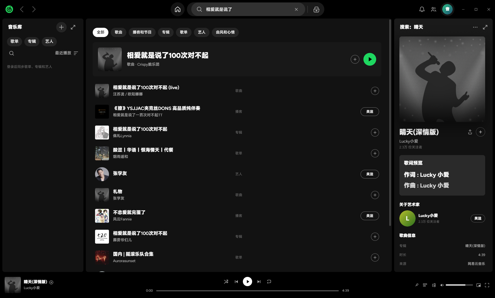
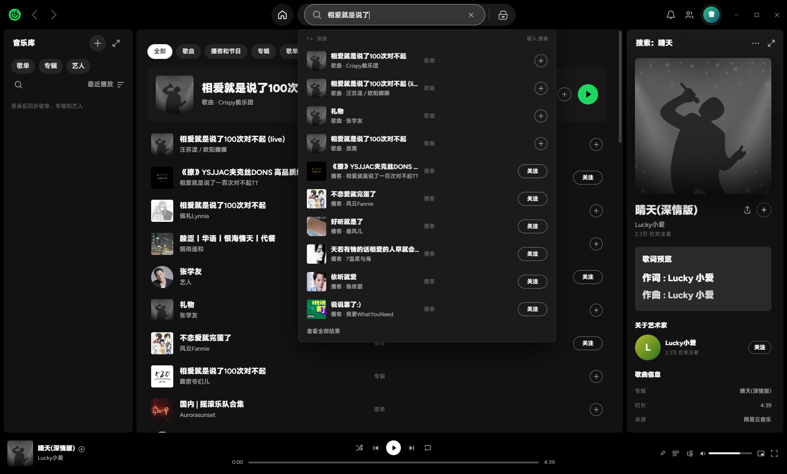
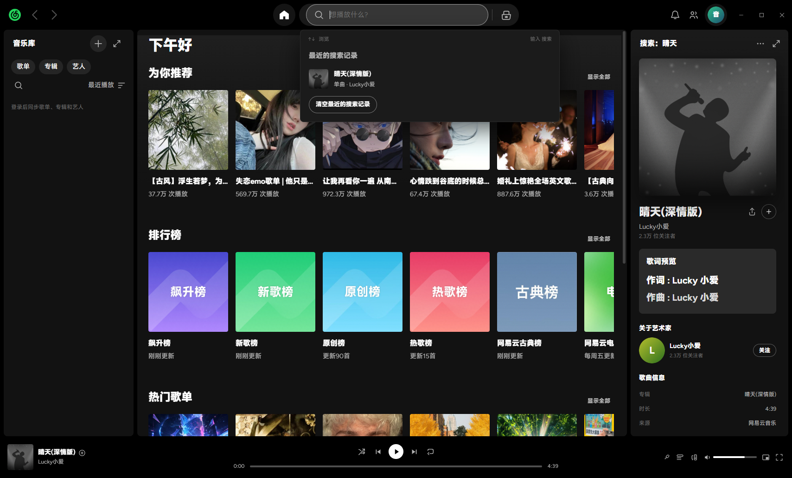
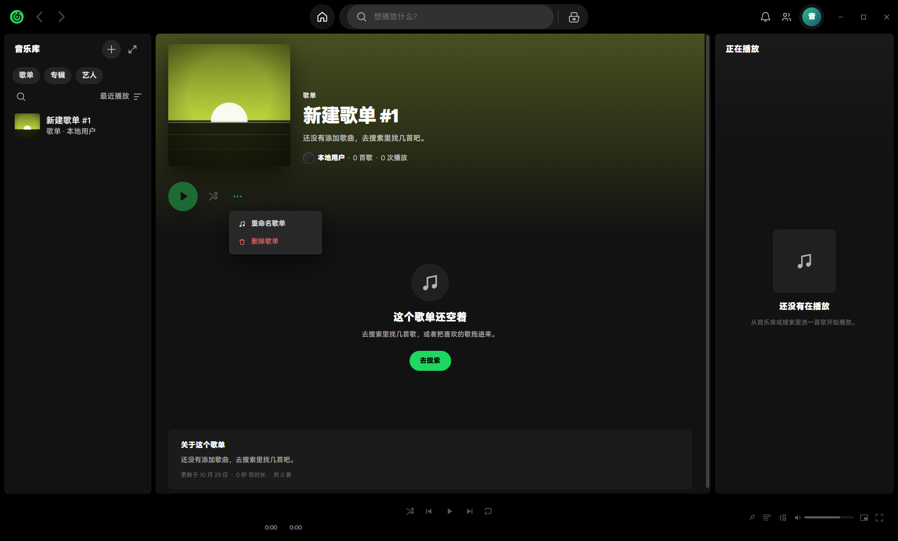
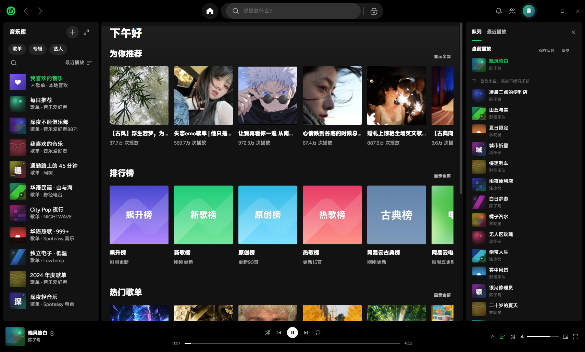
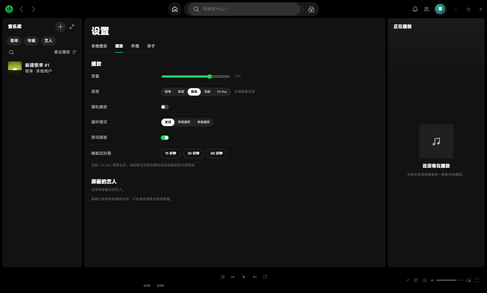


## 0.1.17 播放条缩至 2/3、封面取色、首页卡片黑边、浏览按钮

- 播放条控制按钮整体缩到上一版的 2/3：
  - 随机/循环 28 → 19px，上一首/下一首 26 → 17px，播放白圆 48 → 32px（图标 15px）
  - 中间按钮命中区 36 → 24px，间距 16 → 11px
  - 右侧六键 26 → 17px，命中区 34 → 24px，音量滑杆 140 → 94px
  - 时间 16 → 11px，进度条 6 → 4px，拖动拇指 14 → 10px
  - 左侧歌名/歌手恢复 14/12px
- 随机播放图标按参考图重画：左上短弧、左下到右上的长斜线、右下向右的短箭头，保留两段交叉；选中仍为绿色 + 3px 绿点
- 歌单页背景取色：`PlaylistView` 现在和专辑页一样从封面提取主色相，`--hero-hue/--hero-sat/--hero-sat2` 由封面颜色决定；黑白封面回退中性深色。实测歌单封面提取 hue=70，页面 CSS 也是 70
- 首页卡片外层黑边去掉：卡片的 12px padding 改为 0，card / card-art / cover / cover-img 的 border、outline、box-shadow、background 全部清除，封面直接铺满卡片
- 搜索栏浏览按钮按图 5/6 重画：
  - 未选中：提手 + 梯形包身 + 实心椭圆锁扣
  - 选中：实心提手条 + 实心包身 + 黑色椭圆锁扣
  - 点击现在会真正切到 `#/browse` 浏览页，按钮同时进入选中态；并阻止指针事件被顶栏拖动层吃掉


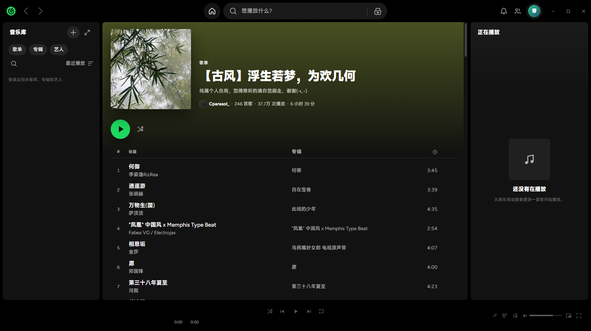

## 0.1.16 播放控制条放大与循环/随机选中态

- 播放条高度保持 90px，但所有控制按钮按参考图放大：
  - 随机、上一首、播放/暂停、下一首、循环：图标 26–28px（原来 16px）；播放/暂停白圆 48px（原来 32px）
  - 右侧：歌词/队列/连接设备/音量/迷你/全屏图标统一 26px（原来 16px），按钮命中区 34px
  - 音量滑杆 100px → 140px
  - 时间字号 12px → 16px，进度条 4px → 6px，拖动拇指 12px → 14px
- 循环播放三种状态：
  - 关闭：灰色圆角回环 + 左下箭头，无圆点
  - 全部循环：绿色图标 + 下方绿色圆点
  - 单曲循环：绿色圆角回环 + 中间数字 1 + 左下箭头 + 绿色圆点
- 随机播放选中：绿色交叉箭头 + 绿色圆点
- 选中态统一使用 `--accent` 绿色，圆点 4px
- 空歌手/无歌曲时的空播放条也同步放大，不再出现空态图标偏小
- 左栏歌名 15px、歌手 13px


## 0.1.15 Bug 清理：热门队列/点赞合并/歌手关注/播放屏蔽/专辑取色

- 热门歌曲默认显示 5 首、展开 10 首，但播放队列恢复为该歌手完整热门 50 首；`TrackList` 新增 `playIds`，显示范围与播放范围分离
- 歌手页「你已点赞」不再只扫热门前 50 首：登录后拉取账号全部喜欢的歌曲，按歌手过滤，再合并本地喜欢
- 「我喜欢的音乐」真正合并本地喜欢：`CloudPersonalView` 同时加载网易云喜欢和本地 liked，未登录但有本地喜欢时也能进入并显示；侧栏/音乐库/首页入口在只有本地喜欢时也会出现
- 歌手页「关注」初始状态用 `netease.myArtists` 判断，已关注歌手打开页面直接显示「已关注」，不再永远显示「关注」
- 「不要播放此艺人的歌曲」变成持久屏蔽：写入本机屏蔽名单，`play` / `addNext` / `addQueue` 都会读取并过滤，重启后仍生效
- 连接设备菜单里的「此电脑」现在点击会关闭菜单，不再是死按钮
- 歌手页先渲染主数据，再异步加载相关歌单/粉丝/参与专辑，不再因为相关接口慢而整页卡在加载态
- 「含有此艺人的歌单」会逐个拉歌单详情验证是否真的包含该艺人，并生成 2×2 拼贴封面；不再只靠搜索标题
- 「参与的专辑」只保留精选/合辑/现场/原声类，不再把该艺人自己的 Remix 单曲混进来
- 相关区块「显示全部」不再固定只展开 8 条，展示接口返回的全部结果（当前上限 20）
- 「每月听众」改成准确的「N 位关注者」：网易云没有 Spotify 的 monthly listeners 字段，不再用错误口径
- 歌手页顶部专辑缩略图按发布时间取最新专辑，而不是拿接口第一张
- 我的歌单重复过滤从「按名字过滤」改成按网易云 specialType=5 过滤，不再误伤用户自己创建的同名歌单
- 好友动态登录失效时显示「登录已失效 / 重新登录」，不再误显示「还没有好友动态」
- 专辑页背景取色改为真正的封面取色：主进程下载专辑封面，用 nativeImage 采样 16×16，跳过黑白和过曝像素，按主色相桶返回 hue；彩色封面用封面主色，黑白封面回退中性黑，不再用歌曲/专辑 id 的随机 hash 色
- 主题色提取有缓存；取色失败时页面保持中性深色


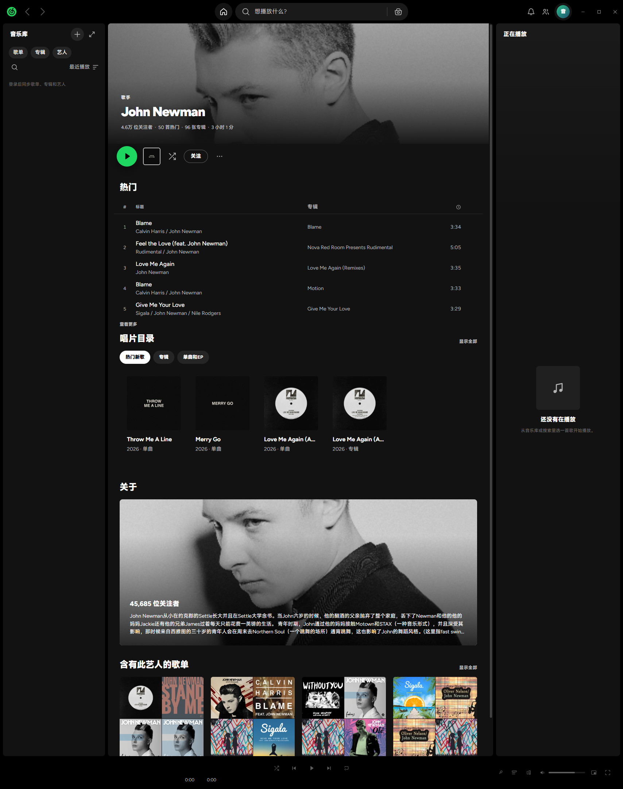

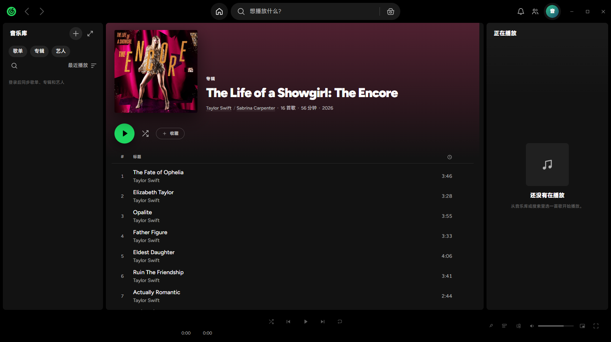
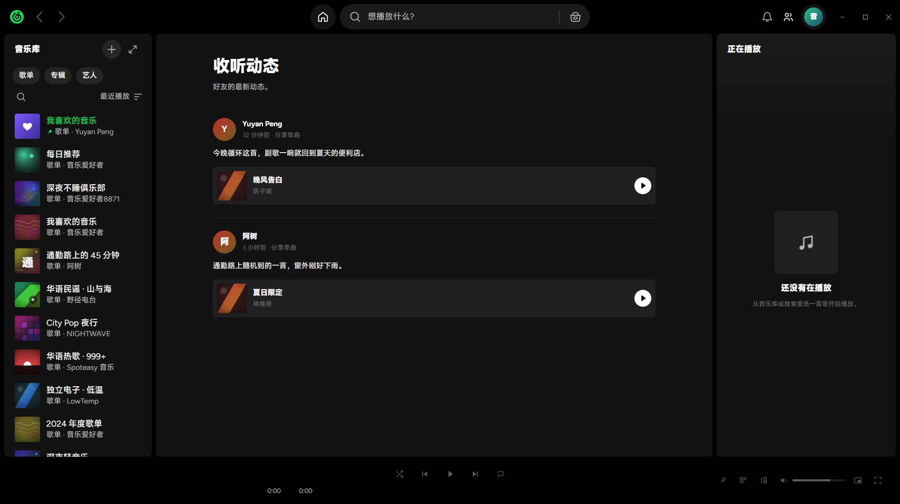

## 0.1.14 排行榜、好友动态去掉点赞、歌手页完整结构

- 「收听动态」移除本地点赞：不再显示点赞按钮/计数，也不再写入 `spoteasy.eventLikes`；好友动态现在只读展示文字、单曲、专辑/歌单/MV 和图片
- 首页在「为你推荐」和「专属推荐」之间新增「排行榜」：来自网易云 `toplist`，卡片显示实时榜单封面、名称和更新频率（每天更新/每周四更新）；「显示全部」进入独立排行榜页
- 歌手页按参考图重排：
  - **热门**：默认 5 首，`查看更多` 展开到 10 首，不显示列表底部的歌曲数/时长
  - **你已点赞**：只在当前歌手有已点赞歌曲时出现；圆形封面 + 绿色爱心，显示「N 首歌曲 / 创建者：歌手」，点击进入合并后的「我喜欢的音乐」
  - **唱片目录**：`热门新歌 / 专辑 / 单曲和EP` 三个胶囊筛选，4 张唱片卡，显示年份·类型，`显示全部` 进入完整唱片列表
  - **关于**：宽幅歌手照片 + 「每月有 N 名听众」+ 三行简介
  - **含有此艺人的歌单**：用歌手名搜索网易云歌单，4 张卡片，`显示全部/收起`
  - **粉丝也喜欢**：网易云 `simi_artist` 相似歌手，圆形头像卡；需要登录，取不到就不显示
  - **参与的专辑**：从歌手专辑里筛出合作/精选/合辑类专辑；没有就不显示
  - 原来的 MV 区块按参考顺序移除
- 「已点赞的歌曲」和「我喜欢的音乐」合并：侧栏/音乐库只保留一个 **我喜欢的音乐**；网易云返回的「我喜欢的音乐」歌单不再重复显示；歌手页「你已点赞」、侧栏、播放栏红心都使用同一份 `likedIds + 本地喜欢`
- 数据说明：网易云没有 Spotify 的「每月听众」字段，这里用歌手关注者数展示同一位置；粉丝/相关数据依赖登录，接口为空时整块隐藏，不填充假数据


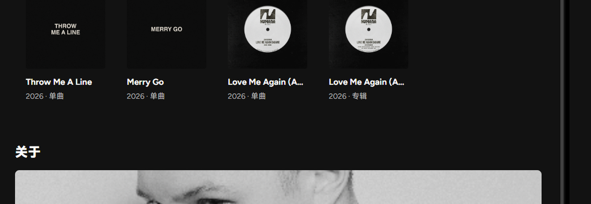


## 0.1.13 拖动修复、艺术家按钮与菜单、播放控件图标

- 顶栏拖动修复：之前 `topbar-left/right` 两组都设了 `no-drag`，把整条顶栏的拖动区盖住了。现在两组本身可拖，只有里面的按钮/搜索框/窗口控制是 `no-drag`，按住 navbar 空白处可以正常拖窗
- 歌手页去掉照片外的红色氛围光：页面底色改为 panel 黑，hero 背景改为 `#121212`，只作用于歌手页；专辑页的氛围色保留
- 歌手页动作区按图 2 重排：绿色播放 56px → 最新专辑封面缩略图 48px（2px 浅色描边）→ 随机 24px → 关注胶囊（36px 高、14px 白字）→ 更多 `…`
- 更多菜单按图 3 实现：关注（真实网易云关注）/ 不要播放此艺人的歌曲（从当前队列移除该艺人并写入本地屏蔽名单）/ 转至艺人电台（用该艺人热门歌曲开随机电台）/ 举报（打开网易云官方举报页面）/ 分享（二级菜单，复制艺人链接）
- 播放控件中间按图 4：随机、上一首、播放/暂停、下一首、循环；循环图标重画成圆角矩形回环 + 左下箭头
- 播放控件右侧按图 5：歌词麦克风、队列、**连接设备**、音量（单弧扬声器）、100px 滑杆、迷你播放器、全屏；连接设备是真实按钮，弹出「此电脑 / 仅支持在本机播放」设备菜单
- 新增截图测试参数 `--shot-click=<selector>`，可以在截图前用程序点击打开菜单/弹层


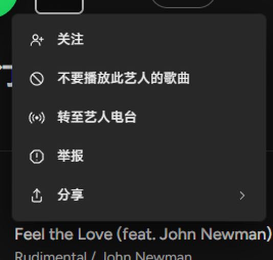

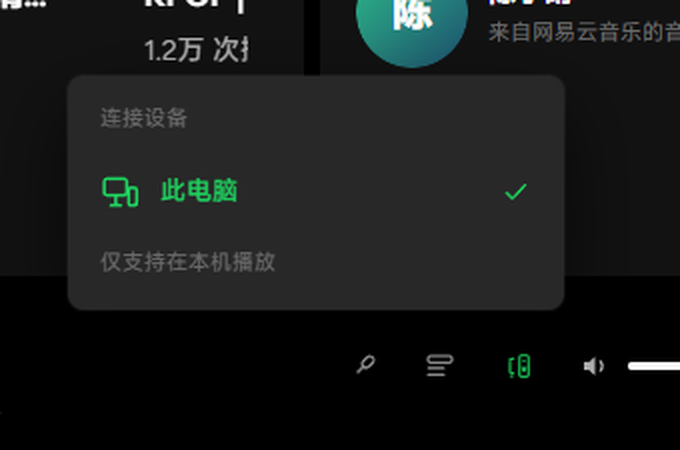

## 0.1.12 搜索浏览按钮、灰卡 rail、常驻播放视图与好友动态

- 搜索框最右侧的浏览按钮按参考图重画：未选中是工具箱轮廓（上提手 + 梯形包身 + 椭圆扣），选中是白色实心 + 黑色椭圆扣
- 收起态音乐库 rail 现在放在一块圆角灰色卡片上（和内容页/播放视图一样的 panel 底色）
- 播放视图改为常驻：每次进入软件都渲染在右侧；没有当前歌曲时显示「还没有在播放」空态，不再自动消失或收起
- 右上角最小化/最大化/关闭图标从 15px 放大到 17px，按钮宽度 46 → 48px
- 「收听动态」从关注歌手的发片信息流改成网易云好友动态：用 `/api/v1/event/get` 拉好友最新动态，支持文字、单曲分享、专辑/歌单/MV 分享、图片；不显示评论入口，也不显示评论数
- 好友动态的点赞目前只保存在本地（网易云没有开放 Web 端动态点赞接口，接口探测返回 404）；UI 会提示「仅保存在本地」，不会伪装成已同步
- 截图/测试参数：`?mock=1` 时好友动态填充示例事件；`html.shot-mode` 禁用动画，保证截图不出现入场淡入残影


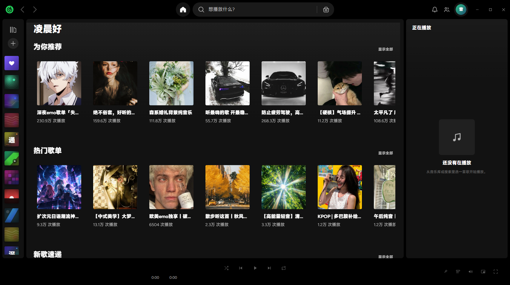
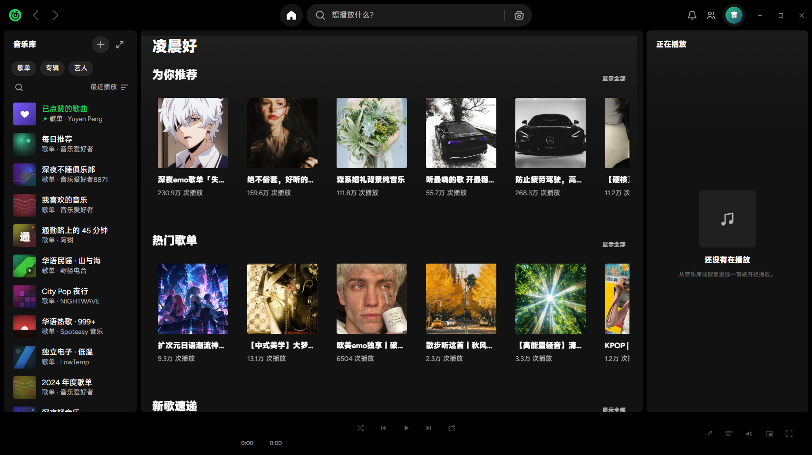

## 0.1.11 底部播放条、全屏歌词、队列与迷你播放器

- 底部播放条按参考图重排：左侧 56px 封面 + 14px 歌名 + 12px 歌手 + 16px 音乐库对勾（绿勾=已加入，空心加号=未加入）
- 中间控制区：随机 16 / 上一首 16 / 播放键 32 / 下一首 16 / 循环 16，进度条与 12px 时间对齐
- 右侧五个按钮依次为歌词（倾斜麦克风）、播放列表（队列图标）、音量（扬声器 + 100px 滑杆）、迷你播放器（画中画）、全屏
- 歌词按钮进入全屏歌词页：顶部显示当前播放来源，大号歌词逐行滚动、当前行白色、点击行 seek；右上角可收藏/转艺人/分享/更多/收起
- 队列按钮把右侧播放视图切换成队列：`队列 / 最近播放` 两个 tab，当前播放、下一首来源、剩余队列；关闭 X 收成右侧窄条
- 迷你播放器是独立的 320×400 置顶小窗：封面铺满，悬停出现顶部六点拖动条 + 关闭和七个悬浮控制键；底部歌名/歌手/绿勾/进度，播放状态与主窗口实时双向同步
- 队列新增「最近播放」历史；播放条对勾切换的是音乐库收藏，不再用红心
- 截图参数新增：`?view=lyrics`、`?view=queue`、`?view=full`；`--mini-shot=<file>` 可截取迷你窗


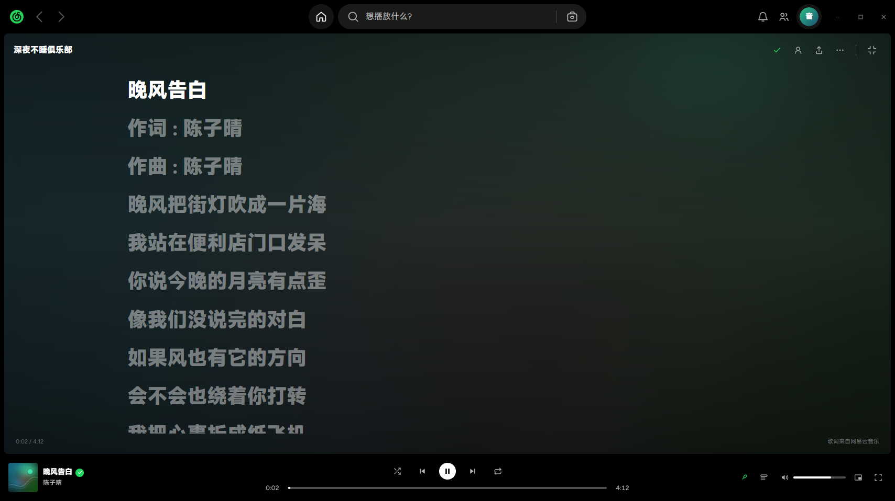


## 0.1.10 播放地址兜底与登录失效提示

- 修复网易云 `weapi` 播放地址偶发返回空 data / `-110` 时整首无法播放的问题：
  现在会先用自建 weapi，失败后自动退回网易云官方 `song_url`，再退回 `standard` 音质
- 播放报错时先静默重试一次；仍失败才暂停并提示，避免瞬时断流直接把整首歌判死
- 报错区分登录态：登录失效会直接提示「网易云登录已失效」并打开扫码登录；版权/会员限制会提示对应原因
- 未登录时也能通过官方兜底播放公开歌曲（会员歌仍只能试听或无地址，和账号权限一致）

## 0.1.9 播放视图折叠/展开、歌词卡片与可调三栏

- 首页内容卡片去掉外圈的黑色投影；右上角头像加上和参考图一致的深灰外环
- 播放视图头部改为「悬浮出收起按钮 + 当前播放来源」：按钮和音乐库一样从左上角滑入，标题随来源显示歌单名/专辑名/歌手名；右侧依次是「更多」「展开」
- 「更多」菜单按参考图重做：加入歌单（二级菜单）、已点赞/喜欢、加入播放队列、睡眠定时器（二级菜单）、转至艺人、转至专辑、分享、立即播放/下一首播放；歌单二级菜单可真实加入
- 「展开播放视图」进入独立全屏视图：模糊封面背景、居中大封面、右上角来源标题和工具栏，最右为缩放按钮；顶栏和底部播放条保留。所有展开按钮在展开后都变成缩放图标（完整音乐库页也一样）
- 歌词卡片：悬停浮现「显示更多」，展开为 **8 行歌词** + 「收起」；后面依次是「关于艺术家」「歌曲信息」「下一首播放」，都在播放视图内滚动
- 播放视图可收起为右侧窄条（灰色卡片 + 左箭头）：悬停时稍微弹出并露出封面，点击重新展开；音乐库折叠只保留 rail，不再留灰色卡片
- 三栏之间新增 8px 可拖拽分隔条：音乐库 220–360px、播放视图 280–460px，主内容保留安全宽度
- 新增截图参数：`?track=t1`（带播放状态）、`?panel=off`（收起为窄条）、`?np=hover|peek`、`?lyrics=1`（8 行歌词）、`?full=1`（全屏播放视图）

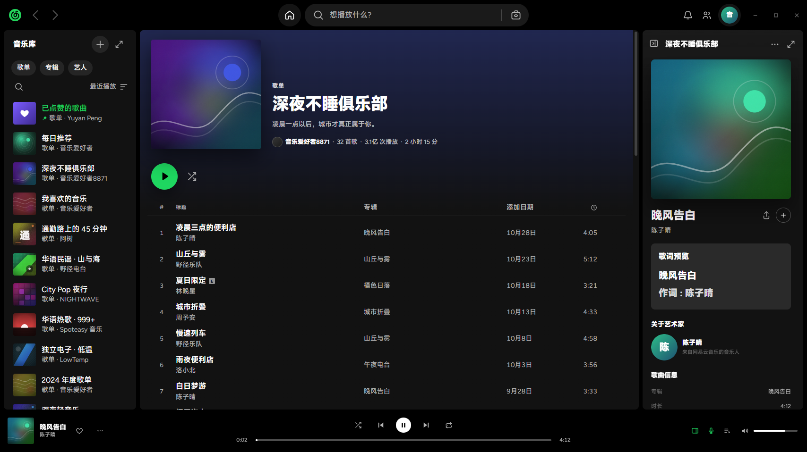
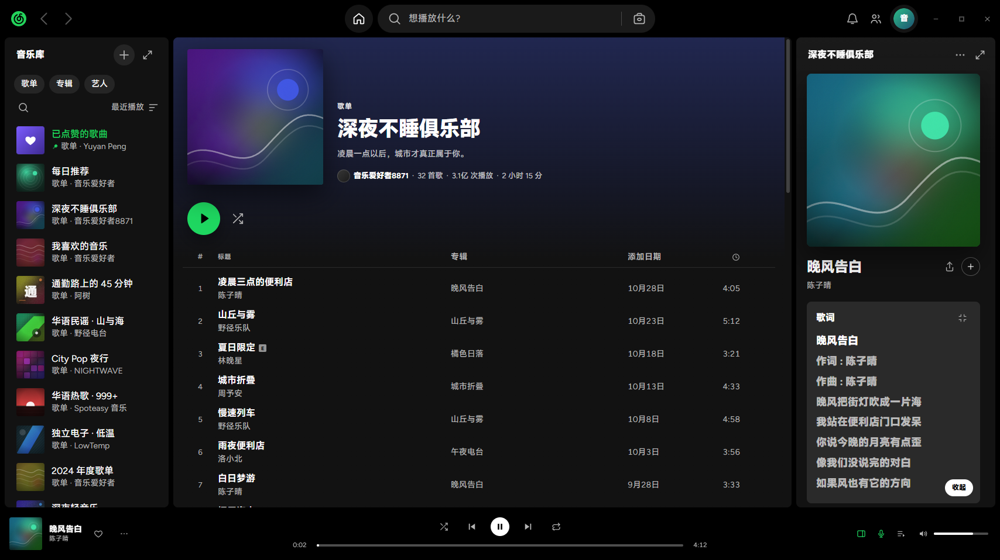
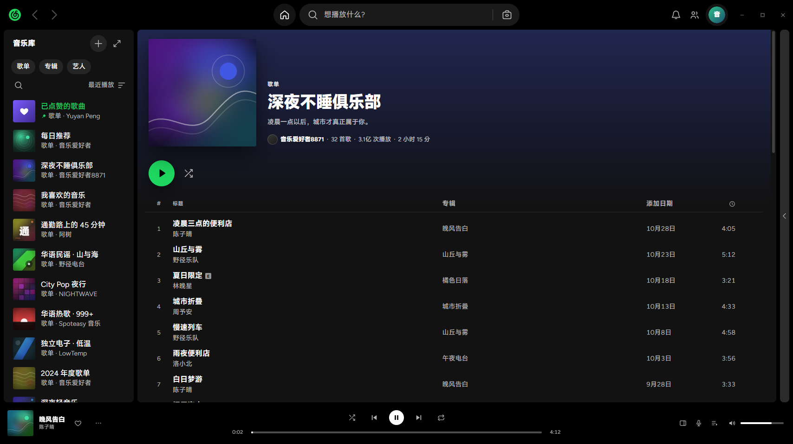
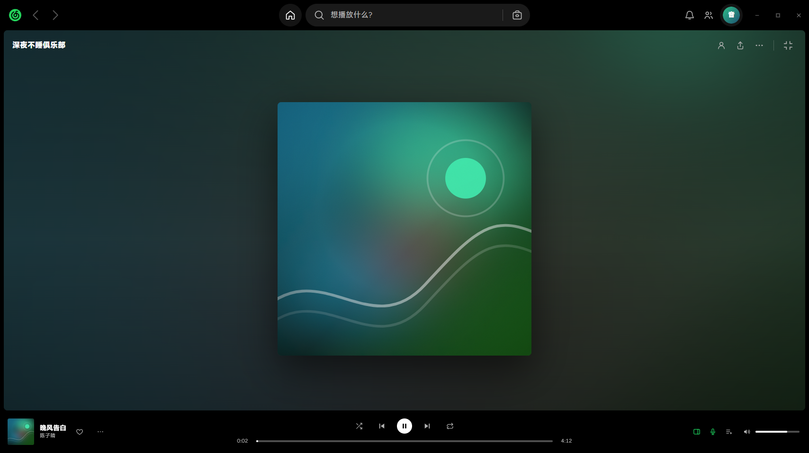

## 0.1.8 独立导航栏 / 浏览 / 新增内容 / 关注动态

- 顶部 navbar 独立纯黑条，左/中/右面板与底部播放条互不相接；三块面板都从 64px 以下开始（8px 圆角与间距）
- 顶栏最左改为 logo（点击仍是应用菜单），后接放大的前进/后退箭头（28px 图标、无底色）
- 主页键固定深灰圆底，不再整键反色；当前页用实心房子、其它页描边房子，只有 hover/press 的轻微缩放
- 搜索栏图标 24px、占位字号 16；右侧接入真正的浏览按钮（箱包 icon），进入浏览页后变白色实心
- 新增 `#/browse` 浏览全部页：4 列彩色分类卡 + 旋转封面，点击分类进入网易云搜索/每日推荐
- 顶栏铃铛 → `#/whats-new`「新增内容」；关注图标 → `#/following`「收听动态」；头像只保留头像（点开仍是账号菜单）
- 新增内容 / 收听动态共用居中 840px 信息流：从 `artist_sublist` 取关注歌手，批量拉 `artist_album`，按发布时间排序；支持 + 收藏专辑、播放整张专辑、音乐/播客筛选
- `?mock=1` 同时填充侧栏与信息流的示例数据；播客筛选暂无数据，朋友的网易云动态流（event）还未接入

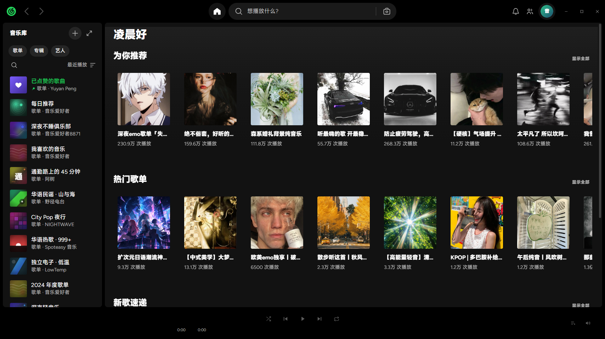
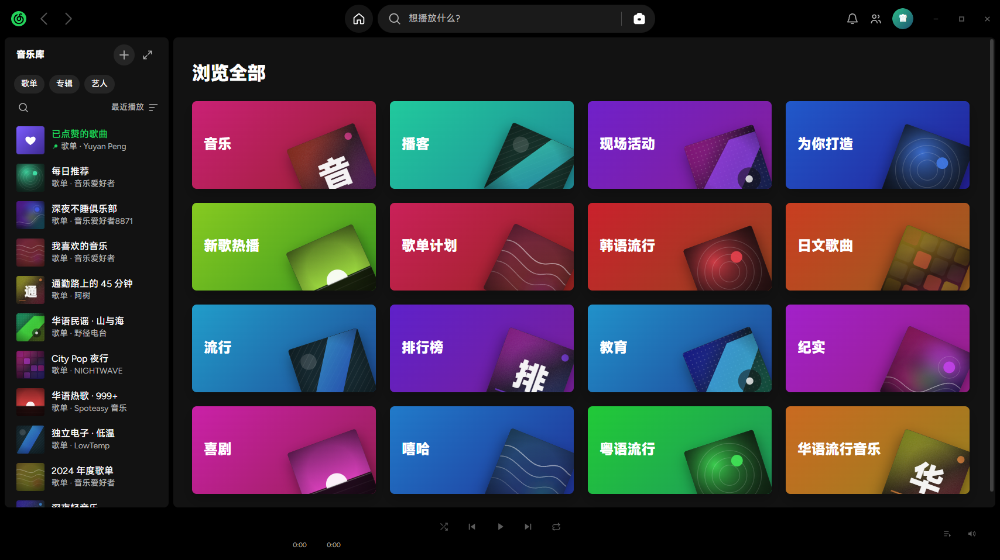
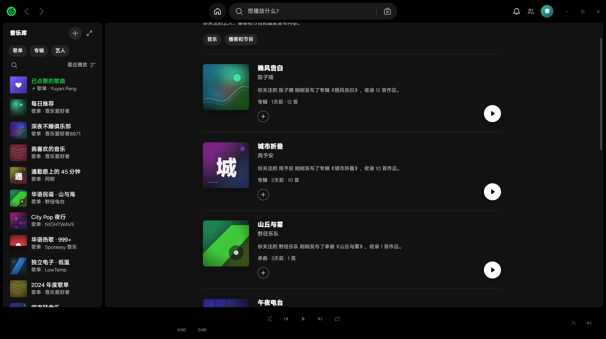
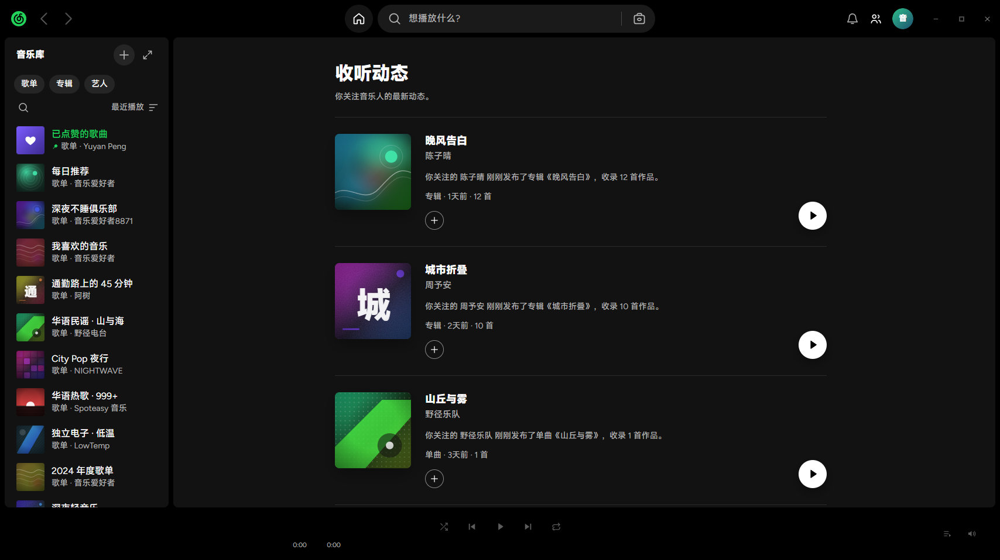

## 0.1.7 音乐库交互与按键比例

- 悬停音乐库时，头部内容右移 24px，左侧滑入「收起音乐库」按钮；移出即还原
- 「+」创建按钮改为 36px 圆形（图标 24px），点击后变成 X，并展开 308px 创建菜单：
  歌单 / 合辑歌单（测试版）/ 共享合辑 / 文件夹；菜单与 + 左边缘对齐，点击外部或 Esc 关闭
- 最大化的展开按钮进入重新排版后的完整音乐库页：16px 标题、右侧「创建」胶囊 + 收起按钮、
  搜索框/排序/视图切换与 9 列网格（1708 宽下）
- 收起态 rail 按实机重排：72px 宽；顶部 40px 音乐库图标 + 36px 创建按钮；
  列表 64px 步进（48px 封面、方形歌单/专辑、圆形艺人）；悬停图标显示右侧「打开音乐库」tooltip
- 侧栏字号与行高对齐 Spotify：行高 64、标题 16/400、副标题 14、筛选 pill 14/32、搜索与排序 icon 化
- 侧栏行 hover 出播放键，已点赞行绿色标题 + 绿色 pin，滚动条悬停才出现
- 截图/深链参数：`?mock=1`（示例数据）、`?lib=hover`、`?lib=create`、`?collapsed=1&tip=1`


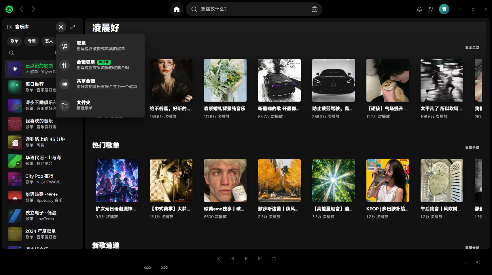
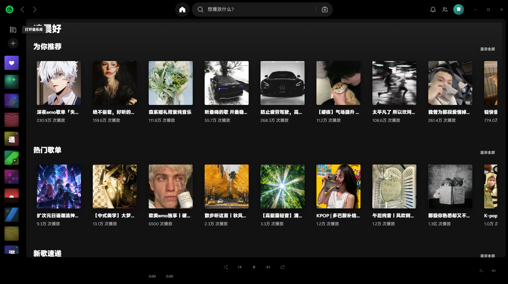

## 0.1.6 完整音乐库

- 新增完整音乐库页：展开后隐藏普通侧栏，7 列网格；歌单/专辑方形、艺人圆形
- 网格/列表视图切换；筛选改为 togglable（默认全部混合，不再只显示单类）
- 搜索框常驻「在音乐库中搜索」；排序改为四项菜单（最近播放/最近添加/字母/创建者）
- 收起态恢复 Spotify 实际形状：歌单/专辑/喜欢方形，艺人圆形；顶部为「打开音乐库」面板按钮 + 48px 创建按钮
- 移除音乐库中的本地音乐行；本地入口移到应用菜单
- 头部 + 48px；展开箭头进入完整音乐库；应用菜单可收起音乐库

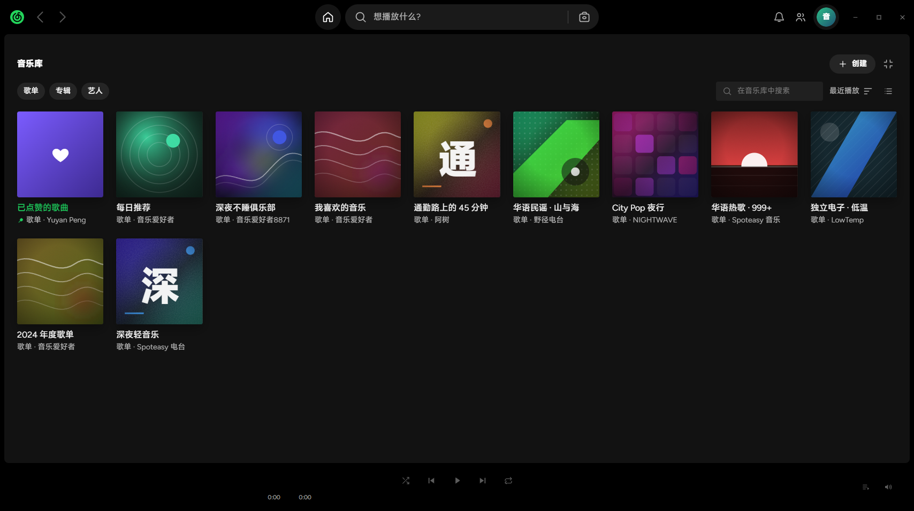


## 0.1.5 图标与音乐库校正

- App 图标使用用户提供的 `spoteasysvg_复制.svg`（绿圆 + 黑色 S），重新生成 PNG/ICO
- 音乐库移除「每日推荐」行（Spotify 的音乐库没有每日推荐，每日推荐只在首页）
- Liked Songs 改名「已点赞的歌曲」，副标题改为「歌单 · 昵称」
- 歌单行副标题改为「歌单 · 创建者」，不再显示曲目数
- 其余音乐库差异见本轮分析

## 0.1.4 音乐库

- 移除「导入本地音乐」卡；本地音乐只保留底部弱入口
- 收起态改为音乐库 rail：顶部音乐库/创建按钮，下面全部是 48px **圆形**封面；不再出现方形图标
- 展开态：歌单方形、艺人圆形；收藏专辑/关注艺人接 `album_sublist` / `artist_sublist`
- 筛选 pill、搜索 icon（点开才输入）、最近播放排序、创建/展开按钮按实机对齐
- 收起态/展开态都使用真实用户数据


## 0.1.3 图标/按钮/关注者

- App 图标改为圆形（绿色圆 + Spoteasy S），不再使用圆角方形底
- 所有图标按钮统一为圆形：32px 常规、48px Home、32px 歌词/队列/侧栏操作、圆形文件夹/展开
- 播放视图与歌手页显示「X 位关注者」，数据来自 `artist_follow_count`
- UI 中不再有「网易云」错误文案
- 保留 6 卡、Show all、单层 Topbar、MV、头像、歌手跳转

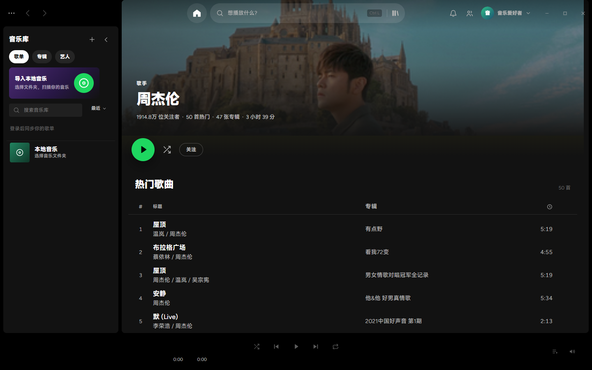

## 0.1.2 实机壳层

按本机 Spotify 实机截图对齐：

- 去掉独立 40px 品牌条；Topbar 全宽，接管窗口控制、Home、通知、好友活动、搜索
- 搜索占位改为「想播放什么?」，快捷键 Ctrl L
- 侧栏去掉 Home/Search 重复导航；改为音乐库头部（创建/收起）、歌单/专辑/艺人筛选、库内搜索/排序；不显示导入音乐卡
- 侧栏行高 40 → 56，封面 28 → 48
- 首页保持 6 张卡片；section 间距 32；顶部渐变 332；每行加真实「显示全部」页
- 新增「专属推荐」栏目（网易云 recommend_resource 有数据时）
- 无歌播放栏改为左侧留空、中间禁用控制，不再显示自定义「未在播放」
- 保留 0.1.1 的 MV、头像、播放栏歌手跳转

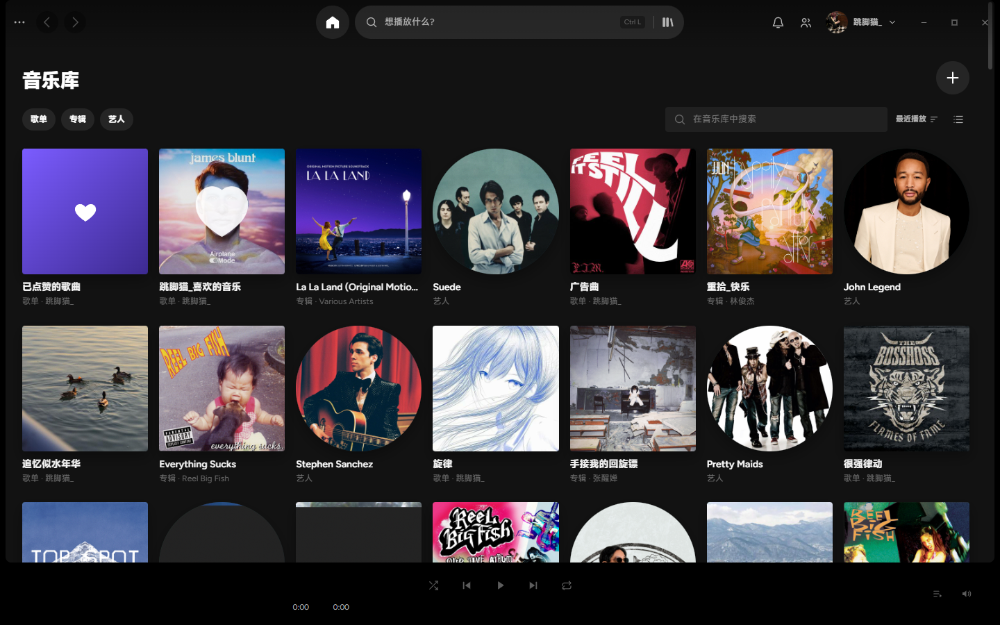

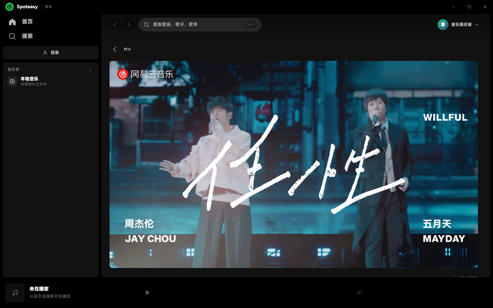

尚未完成：首页 Recently played / Made for you 完整分组、侧栏收藏专辑/关注艺人数据、搜索 Top result、歌手页演出者/关于区块、歌单 CRUD、队列编辑、播放恢复/媒体键、旧 smoke 重写。


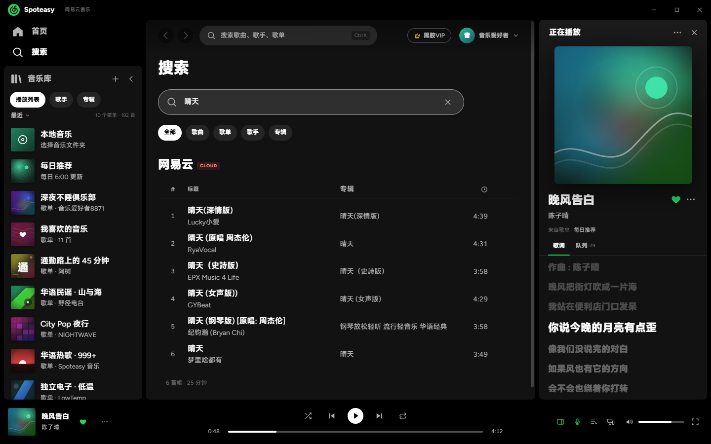
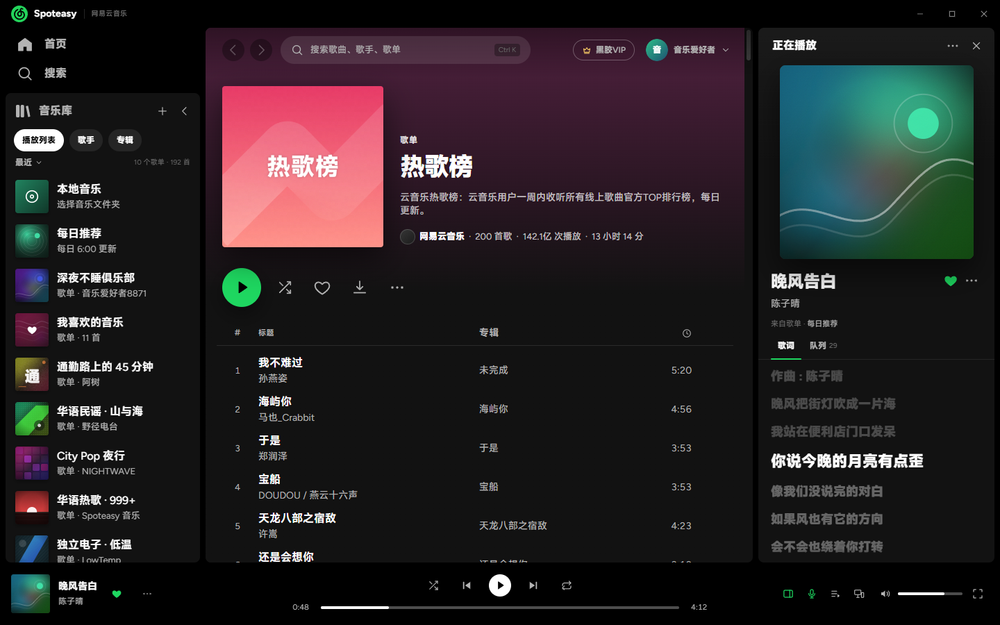

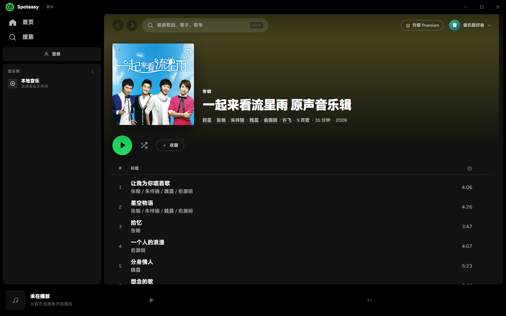
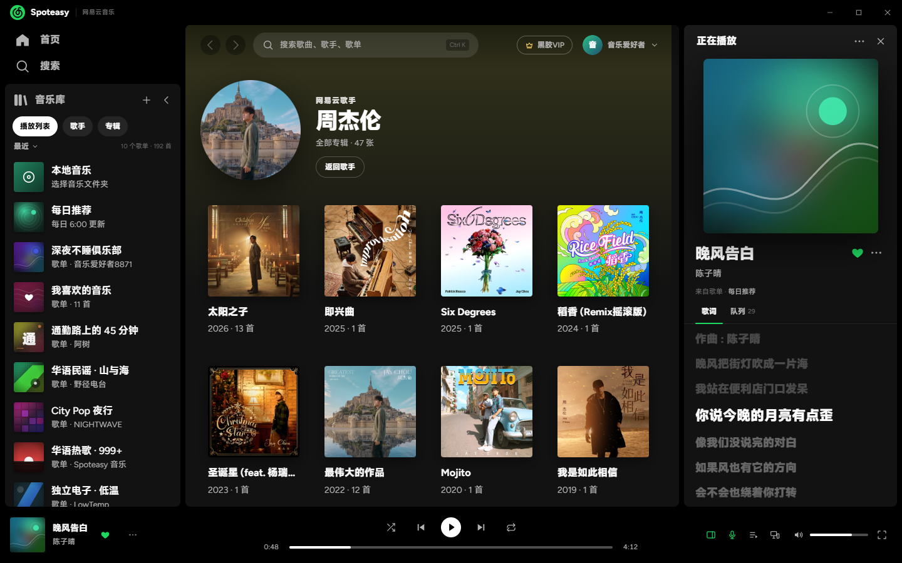
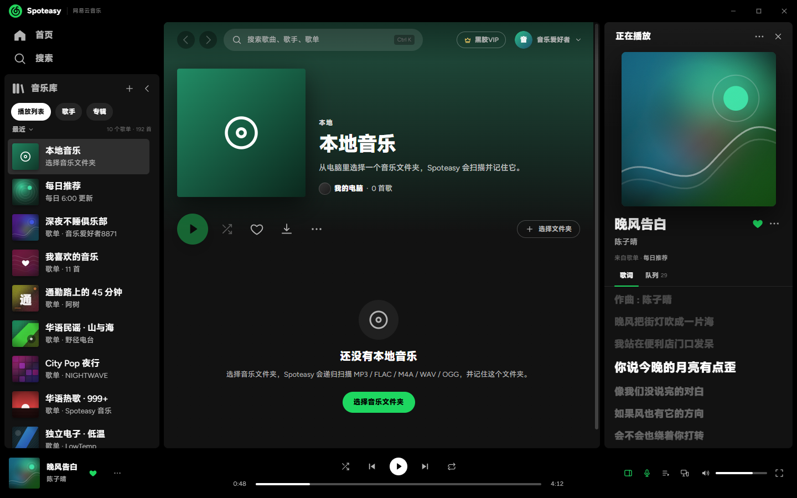
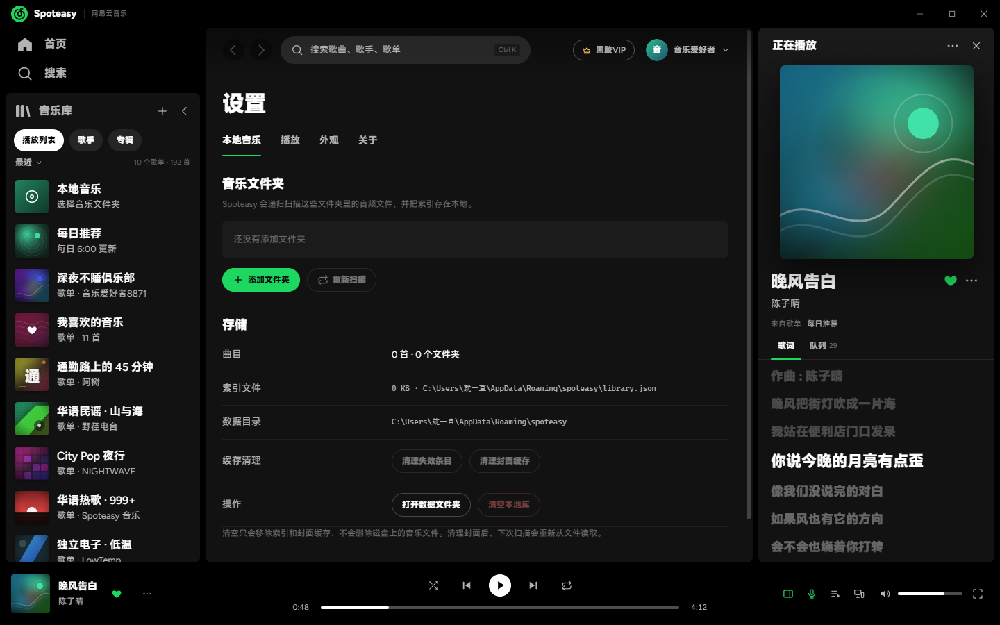

## 快速开始

```bash
pnpm install
pnpm dev
```

| 命令 | 作用 |
| --- | --- |
| `pnpm dev` | 启动 Vite + Electron，带 HMR |
| `pnpm build` | 构建渲染层到 `dist/` |
| `pnpm start` | 直接运行已构建版本 |
| `pnpm shot --route="#/playlist/p1" --out=shots/p1.png --size=1440x900` | 无头截图（临时 userData、关闭 hover、1x DPI） |
| `pnpm smoke` | 在 Electron 里跑一遍交互冒烟 |
| `pnpm icon` | 把 `build/spoteasy-icon.svg` 渲染成 `build/icon.png` |

> 国内网络提示：Electron 二进制约 150 MB，可先设置
> `ELECTRON_MIRROR=https://npmmirror.com/mirrors/electron/`；
> 依赖用 `pnpm install --registry=https://registry.npmmirror.com`。
> 如果 Electron 的 postinstall 被跳过，执行 `node node_modules/electron/install.js` 补装；
> 如果 GitHub 下载超时，可把 `%LOCALAPPDATA%\electron\Cache` 里已有的
> `electron-v45.0.0-win32-x64.zip` 解压到 `node_modules/electron/dist/`，并写入
> `node_modules/electron/path.txt`（内容为 `electron.exe`）。

> 在 Electron 宿主环境（例如 DSH 本身）里启动时，继承来的 `ELECTRON_RUN_AS_NODE=1`
> 会让 Electron 退化成普通 Node，报 `app.commandLine` undefined。`scripts/dev.mjs`、
> `shot.mjs`、`render-icon.mjs` 都已自动清掉这个变量。

## 网易云接入（MVP）

目前已经接通：

- **云端搜索**：搜索页会并行请求网易云，歌曲结果放在「网易云 CLOUD」区域，歌单/歌手/专辑分别成区；歌曲、歌单、歌手、专辑都支持「加载更多」分页。
- **首页推荐**：首页新增「网易云推荐」横向卡片架，数据来自 `personalized`，点卡片进入云歌单页。
- **云歌单页**：`playlist_detail + playlist_track_all`，展示真实封面、创建者、播放量、描述和曲目；首屏 100 首，底部「加载更多」继续加载，200 首热歌榜可完整展开；播放全部/随机可用。
- **云歌手 / 云专辑**：搜索里展示云歌手、云专辑卡片；歌手页走 `artist_detail + artist_songs`（热门 50 首、圆形真实头像）+ `artist_album`（专辑架）；「显示全部」进入 Spotify 风格的 Discography 页，按 30 张分页加载全部专辑；专辑页走 `album`（真实封面、多艺人拆分链接、年份、曲目）。
- **我的音乐（需登录）**：侧栏新增「我的音乐」区：每日推荐、我喜欢的音乐（红心数量）、我的歌单；云歌曲红心会真实写回网易云，并同步侧栏计数 / 播放栏 / 正在播放 / 我喜欢的音乐页。
- **二维码登录**：头像菜单/会员状态药丸 → 二维码弹窗；扫码确认后保存会话，重启保持登录；支持退出登录。
- **云端播放**：主进程注册 `spoteasy-cloud://stream/<songId>?level=<quality>`，先解析 `song/url/v1`，再带 Referer/Range 代理 CDN 流；`<audio>` 播放，进度/seek/上一首/下一首/自动下一首和本地一致。
- **音质选择**：设置 → 播放 → 音质，支持 标准 / 较高 / 极高 / 无损 / Hi-Res；选择写入 localStorage，云端歌曲播放时带 `level`；无权限或不可用时自动降级。
- **云端歌词**：`lyric` 接口返回 LRC，渲染层解析后接入现有歌词面板；没有歌词时显示空状态。
- **账号状态**：登录后读取昵称与真实头像；账号权限决定能播放的曲目。
- **会话安全**：`MUSIC_U` 等 cookie 只存在主进程，用 Electron `safeStorage` 加密落到 `userData/netease-session.bin`，不暴露给渲染层。

实现上：

- `electron/netease/client.cjs`：weapi 加密 + 搜索 / 歌曲 URL / 歌词
- `NeteaseCloudMusicApi@4.32.0`：二维码 key/create/check、登录状态
- `spoteasy-cloud://`：流式代理，URL 缓存 8 分钟，403/404 时重取一次
- `src/state/netease.tsx`：云搜索、已知云曲目、歌词缓存、登录状态
- `src/components/LoginDialog.tsx`：二维码弹窗与轮询
- `src/data/lrc.ts`：LRC 解析

## 本地音乐库

侧栏最上方的 **本地音乐** → 选择文件夹。Spoteasy 会递归扫描：

- **格式**：MP3 / FLAC / M4A / AAC / WAV / OGG / OPUS / WEBM
- **元数据**：标题、艺人、专辑、时长（`music-metadata`）
- **封面**：内嵌专辑图会被缩到 320px 存成 data URL
- **持久化**：扫描结果写到 Electron `userData/library.json`，下次启动直接加载；换文件夹或重新扫描时保留原来的「添加日期」
- **真实播放**：主进程注册 `spoteasy-media://` 协议，按 Range 返回本地文件；渲染层用 `<audio>` 播放，暂停/续播/seek/音量/上一首/下一首/自动下一首都可用
- **自动监听**：`fs.watch` 递归监听每个文件夹，1.2s 去抖后重扫并通过 `library:changed` 推给渲染层；新增/删除文件会自动出现在本地页和侧栏
- **编辑信息**：本地歌曲右键 →「编辑歌曲信息」，可改标题/艺人/专辑，或用「更换封面」选图（320px JPEG）；这些是应用内 overrides，存在 `library.json`，不写入音频文件标签
- **缓存清理**：设置页可清理失效条目（文件已删除）或封面缓存；重新扫描会从文件重新读取封面

> 扫描是递归的，会跳过隐藏目录；同一路径只保留一份（按文件路径去重）。没有标签的文件用文件名当标题，艺人和专辑显示「未知艺人 / 未知专辑」。搜索（页面搜索 + Ctrl K）和侧栏的歌手/专辑都会把本地曲库与示例曲库合并。

## 设置页

头像菜单 → 设置，或直接 `#/settings`。大标题 + 横向 tab，active 2px 主色下划线。

- **本地音乐**：文件夹列表（曲目数/路径）、添加文件夹、移除文件夹、重新扫描、索引大小与路径、打开数据目录、失效条目/封面缓存清理、清空本地库
- **播放**：音质（标准/较高/极高/无损/Hi-Res）、音量、随机播放、循环模式（关闭/列表/单曲）、歌词面板开关
- **外观**：Spotify 绿 / 网易云红、纯黑模式、恢复默认
- **关于**：版本、Electron/Chromium/Node、本地库路径

「清空本地库」只删索引和封面缓存，不会删除磁盘上的音乐文件。

## 歌手 / 专辑详情页

从侧栏「歌手 / 专辑」、搜索结果、右键「前往歌手/专辑」进入：

- **歌手页**：圆形头像、全部歌曲、专辑卡片架；播放全部/随机；关注（演示）
- **专辑页**：方形封面、艺人链接、曲目表；播放全部/随机/收藏
- 详情页的曲目表仍然走真实播放；本地和示例曲库都会聚合进来

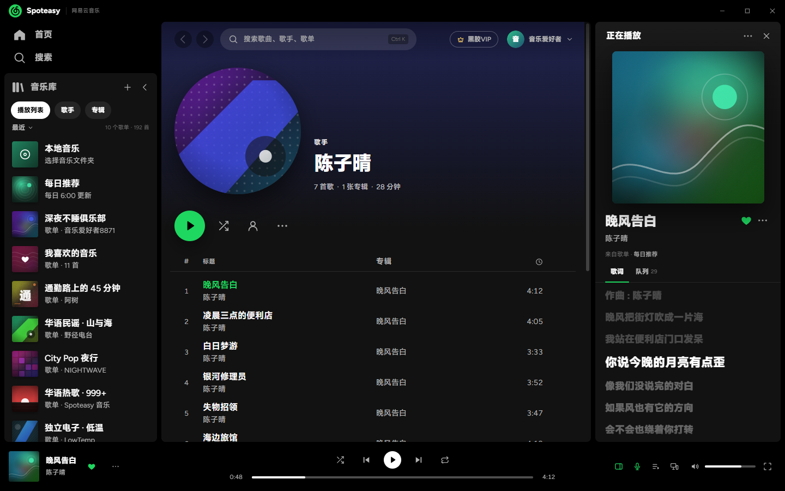
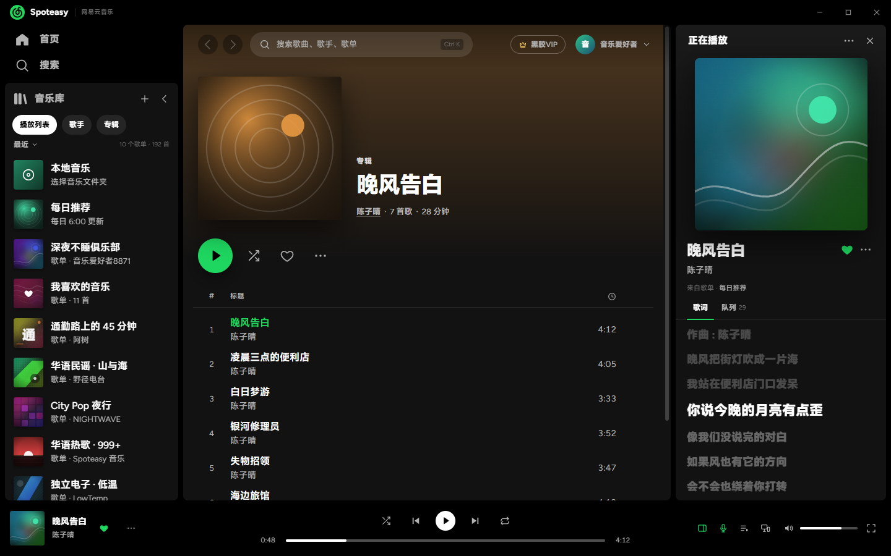

## 编辑与缓存

本地歌曲右键菜单多了「编辑歌曲信息」：

- 改标题 / 艺人 / 专辑，保存后本地页、播放条、队列、搜索一起更新
- 「更换封面」选本地图片，缩成 320px JPEG 存进 overrides
- 修改会跨重新扫描保留；删除文件夹或清空本地库时一并清理
- 只改 Spoteasy 内的显示，不写入 MP3/FLAC 标签

设置页的「缓存清理」：

- **清理失效条目**：删除 `library.json` 里文件已不存在的曲目
- **清理封面缓存**：移除所有封面 data URL，下次扫描会重新读取
- 两项都只动索引，不删除磁盘文件

## 它长什么样

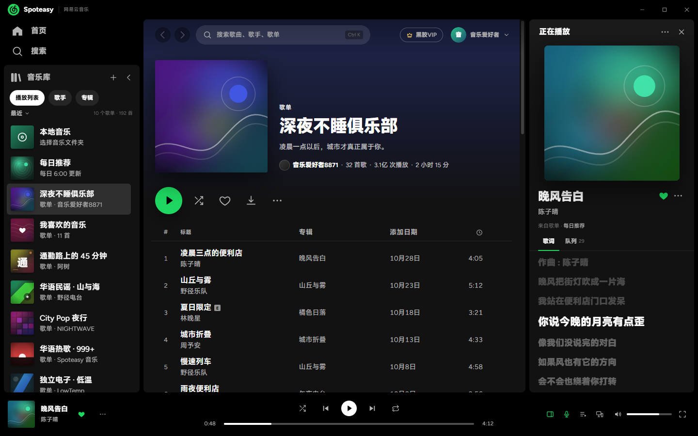


## Spotify 细节

**窗口与骨架**

- 无边框自绘标题栏：Spoteasy 标记、拖拽区、最小化/最大化/关闭、双击最大化
- 三栏 + 90px 底栏；左侧音乐库可折叠到 72px 图标条；右侧面板可开关
- 8px 圆角面板、8px 间隙、语义化颜色 token；1080px 以下右栏自动变为浮层

**左侧栏**

- 首页 / 搜索两个入口 + 本地音乐
- 音乐库三种筛选（播放列表 / 歌手 / 专辑）、排序切换、数量统计
- 行内 hover 播放键、当前歌单高亮、HTML5 拖拽重排歌单

**主区**

- 顶栏：后退/前进历史栈、Ctrl K 搜索胶囊、会员状态、头像菜单（主题色、纯黑模式）
- 首页：按时段问候、3 列最近播放快捷格、横向卡片架（hover 播放键）
- 歌单页：取封面色相的渐变 hero、按可用宽度自动收缩的标题字号、播放/随机/关注或收藏
- 曲目表：hover 用播放键替换序号、正在播放等化器、E 标、添加日期、时长列对齐
- 搜索页：热门搜索、Browse all 彩色分类卡、热门歌单、热门歌手；**搜索歌曲/歌手/专辑覆盖本地 + 示例曲库，并并行请求网易云**
- 本地音乐页：文件夹选择/重新扫描、扫描进度条、空状态、自动监听
- 歌手页 / 专辑页：圆形歌手头像、方形专辑封面、播放全部/随机/收藏、专辑卡片架
- 编辑弹窗：本地歌曲标题/艺人/专辑、封面预览与更换
- 设置页：本地音乐 / 播放 / 外观 / 关于；文件夹增删、失效条目/封面缓存清理、音量/循环/歌词面板、主题色与纯黑模式

**细节与动效**

- Figtree Variable（拉丁/数字）+ MiSans（中文）
- 播放条 32px 播放键、6 个右侧图标、深色自绘 tooltip
- 右栏开合宽度过渡；tab 下划线滑动；红心弹跳；切歌封面淡入（有内嵌封面时直接显示）
- 滚动条只在悬停时出现；主区顶部渐变

**播放**

- 本地歌曲：真实音频 + 进度同步 + 自动下一首 + 循环（单曲/列表）
- 网易云歌曲：`spoteasy-cloud://` 代理 CDN 流，进度/seek/切歌与本地一致
- mock 歌单：250ms tick 模拟进度（用于界面演示）
- 进度/音量拖拽、hover 时间气泡、静音

**右侧面板**

- 歌词：示例曲目和网易云歌曲都有歌词；本地歌曲暂无歌词
- 队列：接下来播放、来源上下文

**交互**

- 快捷键：Space、←/→ 5 秒、Ctrl+←/→ 切歌、Ctrl+K 搜索、Alt+←/→ 前进后退、Esc
- 右键菜单：立即播放 / 下一首播放 / 加入队列 / 前往歌手 / 前往专辑 / 观看 MV / 编辑歌曲信息（本地）/ 喜欢 / 复制链接（云端）

## 品牌资源

| 文件 | 用途 |
| --- | --- |
| `src/assets/spoteasy-mark.svg` | 标题栏左侧的 Spoteasy 标记（你提供的 SVG） |
| `build/spoteasy-icon.svg` | App 图标源文件（你提供的黑底圆角图标） |
| `build/icon.png` | 由 `pnpm icon` 渲染的 256×256 窗口/任务栏图标 |

## 目录

```
electron/        主进程（窗口、本地库扫描、spoteasy-media、spoteasy-cloud）
electron/netease/client.cjs  weapi 搜索 / 歌曲 URL / 歌词
electron/netease/            登录会话、二维码、云流代理（main.cjs 内）
build/           spoteasy-icon.svg / icon.png
src/
  App.tsx        布局、路由/历史、快捷键、增删歌单
  routing.ts     hash 路由 + 截图深链参数
  components/    Titlebar / Sidebar / Topbar / HomeView / PlaylistView /
                 LocalView / SettingsView / SearchView / CollectionView /
                 CloudPlaylistView / CloudCollectionView / CloudArtistAlbumsView /
                 CloudPersonalView / EditTrackDialog / LoginDialog / NowPlaying / PlayerBar / TrackList /
                 ContextMenu / SearchOverlay / Toasts / CoverArt / Icons
  data/mock.ts   32 首示例歌曲、10 个歌单、歌词
  data/derive.ts 本地 + 示例曲库的歌手/专辑聚合
  data/lrc.ts    LRC 歌词解析
  state/         library（本地库）、netease（云搜索/登录/歌词）、player、ui
  styles/        tokens.css + global.css
scripts/         dev.mjs / shot.mjs / smoke.mjs / render-icon.mjs
```

## 设计取舍

- **按 Spotify 的骨架和交互对齐**：三栏、播放条、卡片、表格、菜单、tooltip 的尺寸与动效都照着做；内容只保留音乐。
- **真实播放走本地 + 自定义协议**：本地文件走 `spoteasy-media://`，网易云走 `spoteasy-cloud://`；不套网页版，主进程统一 Range/Referer，渲染层 `<audio>` 播放。
- **网易云内容接入**：搜索、播放地址和歌词由主进程处理，二维码登录会保存本地会话。
- **登录会话不进渲染层**：cookie 用 `safeStorage` 加密保存在主进程侧，渲染层只拿状态。
- **编辑是应用内 overrides**：标签/封面改动只写 `library.json`，不碰音频文件；跨扫描保留，权限和格式风险最小。
- **自动监听用全量重扫**：`fs.watch` 只负责触发，1.2s 去抖后走同一条扫描链路，保证元数据和封面一致；大库会有延迟。
- **mock 与本地并存**：示例歌单用来展示界面，本地音乐是真实数据；登录后侧栏会额外出现「每日推荐 / 我喜欢的音乐 / 我的歌单」。
- **标题自适应**：`PlaylistView` 用 `ResizeObserver` 从 36px 开始按可用宽度收缩（按你的要求从 72px 减半）。
- **设置页结构**：大标题 + 横向 tab，active 2px 主色下划线；行内 220px 标签 + 控件两列，窄容器自动堆叠。
- **截图与验证**：`shot.mjs` 用独立 userData、1x DPI、关闭 hover 命中保证可复现；`smoke.mjs` 在真实 Electron 里点一遍关键路径（也用独立 userData，不污染配置）。

## 已知限制 / 下一步

- 网易云目前接了 **搜索 / 首页推荐 / 云歌单 / 云歌手 / 云专辑 / 全部专辑 / 我的歌单 / 我喜欢的音乐 / 每日推荐 / 播放 / 歌词 / QR 登录 / 音质**；我的音乐数据需要扫码登录后才有。
- 我的歌单 / 喜欢 / 每日推荐已接网易云接口和侧栏入口；当前环境没有登录态，真实账号数据需要扫码后验证。
- 搜索四类结果已支持分页；云歌手页热门 50 首 + 专辑架 12 张，「显示全部」页按 30 张分页加载全部专辑。
- 云歌单首屏 100 首，加载更多按 100 首追加；云专辑页把多艺人拆成独立链接。
- 音质选择已接；无损/Hi-Res 仍取决于账号权限，不可用时自动降级。
- 云端搜索结果不写入本地库，只存在当前会话；云端封面直接走网易云 CDN，没有落盘缓存。
- 云歌单里很多歌需要登录/会员才能播放；红心写回依赖网易云登录态。
- 本地歌曲没有歌词；示例曲目和网易云歌曲有歌词。
- 自动监听触发全量重扫，大库会有延迟和 CPU 开销；没有增量索引。
- 标签编辑/封面替换只写 Spoteasy 的 overrides，不写音频文件标签；没有批量编辑。
- 歌手/专辑按名称聚合，同名专辑会合并；没有年份、厂牌、多艺人拆分。
- mock 歌曲仍然没有声音（模拟进度）；真实播放只针对本地库和网易云。
- 下一步建议：播放会话/媒体键 → 写回文件标签 → 增量索引；网易云侧可继续补「最近播放 / 云盘 / 关注歌手」。

## 环境

- Node 24 / pnpm 11 / Electron 45 / React 19 / Vite 7
- `music-metadata` 12（主进程扫描）
- `NeteaseCloudMusicApi` 4.32.0（二维码登录 / 登录状态；MIT）
- Windows 优先；macOS 下窗口按钮样式需另做
